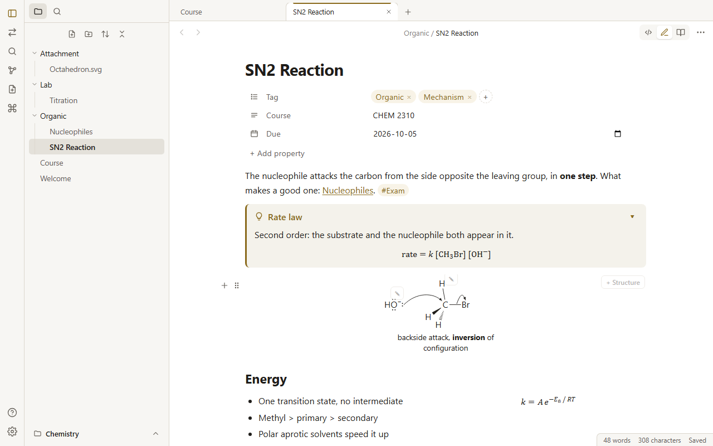
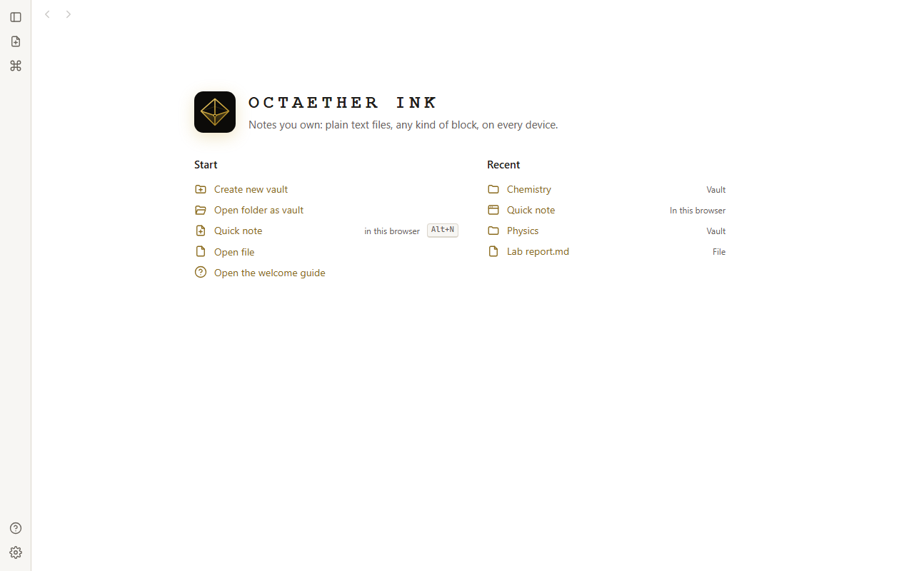
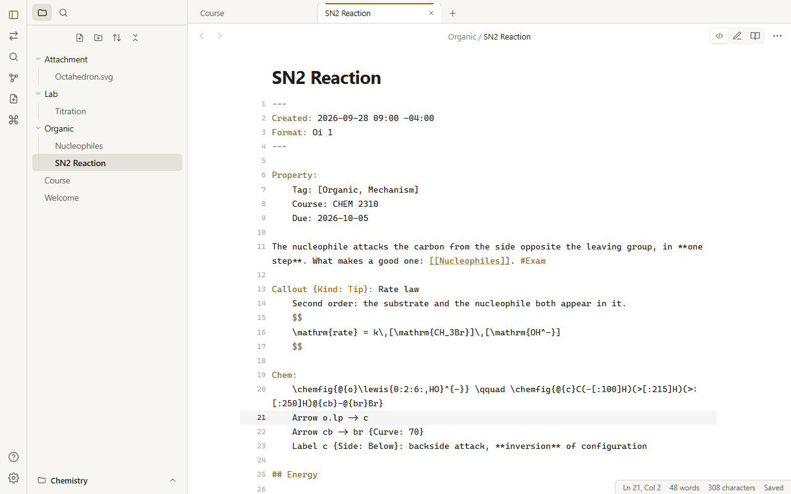
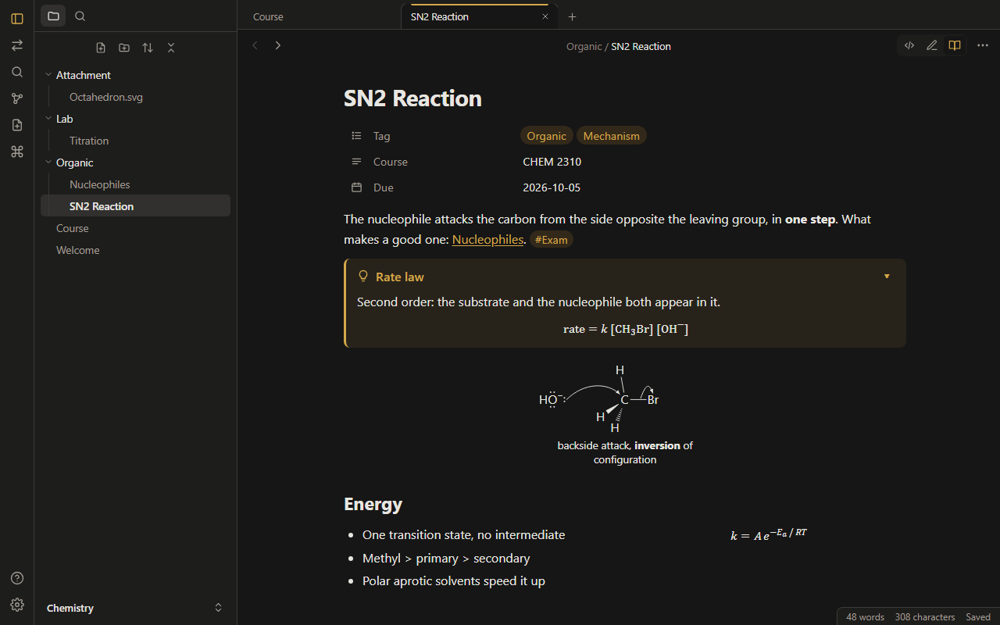
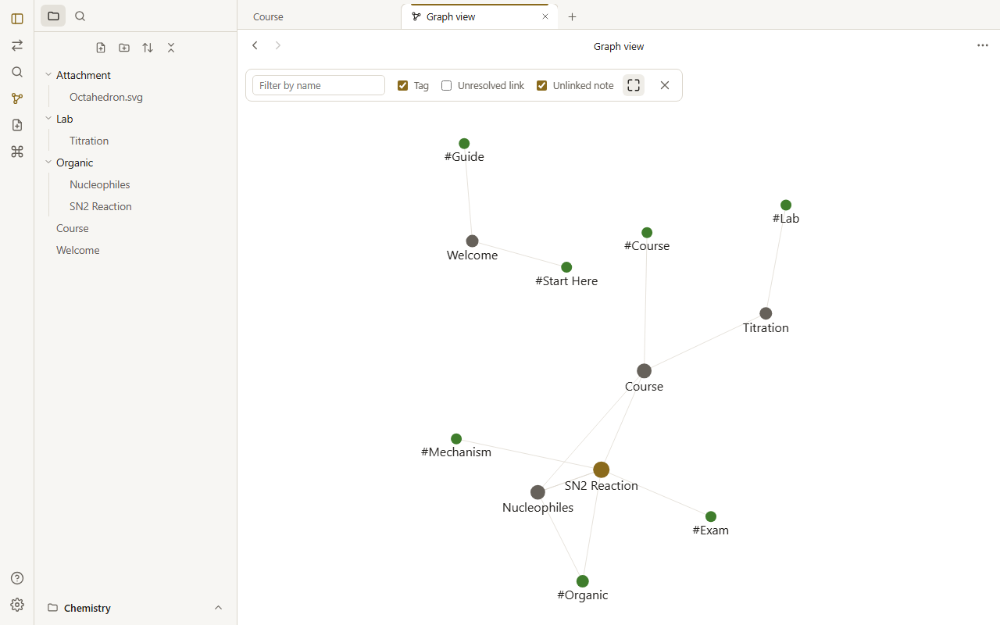
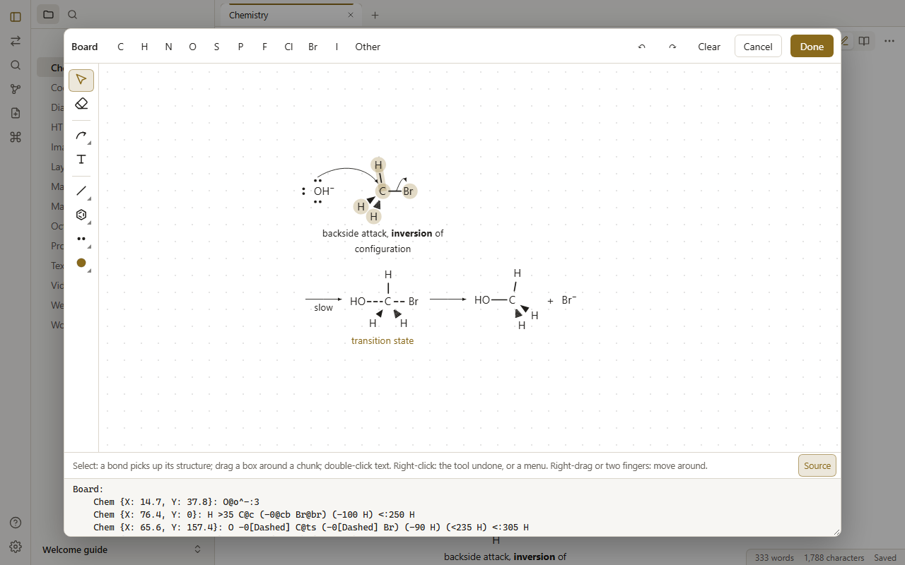
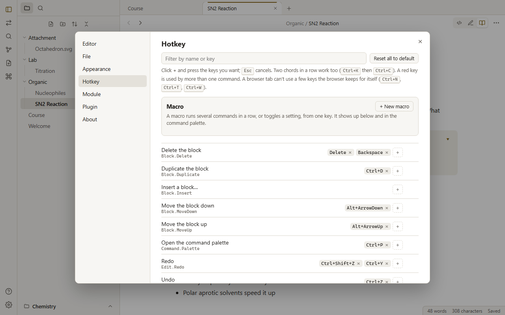
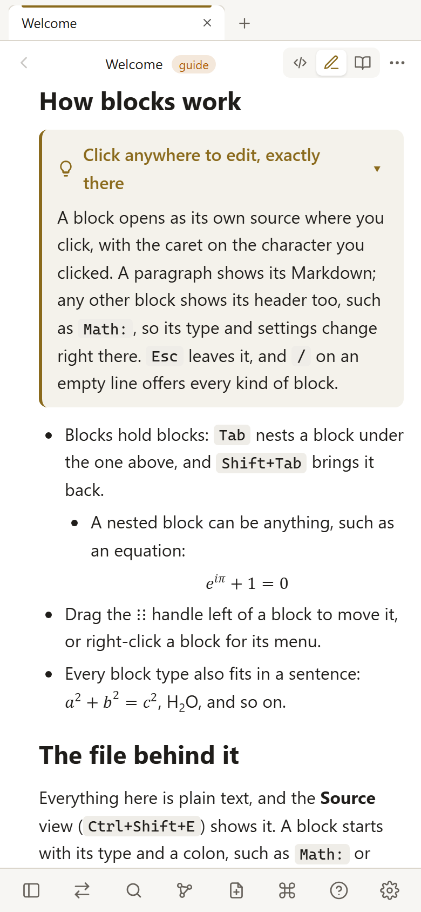

<p align="center">
  
</p>

<h1 align="center">Octaether Ink (OI)</h1>

<p align="center">
  <b>Local‑first, block‑based notes.</b> Plain‑text <code>.oi</code> files you own, with text, math, chemistry, code, TikZ drawings, tables, plots, calendars, boards, pictures, videos, and callouts in one note.<br>
  Works in the browser today; desktop, iPad, and phone apps come next.
</p>

<p align="center">
  <a href="https://ink.octaether.com"><b>Open the web app</b></a> ·
  <a href="#quick-start">Run it locally</a> ·
  <a href="#using-octaether-ink">User guide</a> ·
  <a href="#deploy">Deploy</a> ·
  <a href="#roadmap--todo">Roadmap &amp; TODO</a> ·
  <a href="#specification">Specification</a>
</p>



> **Status: version 1**, file format `Format: Oi 1`. Everything in the [user guide](#using-octaether-ink) works now. The [specification](#specification) is the design the build follows, and the [roadmap](#roadmap--todo) tracks what is done and what is next.
> Website: [octaether.com](https://octaether.com) · Licence: [MIT](LICENSE)

## Contents

- [Highlights](#highlights)
- [Quick start](#quick-start)
- [Using Octaether Ink](#using-octaether-ink): [first launch](#first-launch-a-vault-a-quick-note-or-a-file), [files](#files-new-save-rename-delete), [tabs](#tabs), [views](#three-views-source-edit-read), [blocks](#writing-with-blocks), [media](#pictures-videos-markdown-and-html), [note top](#the-top-of-a-note-name-properties-and-page-layout), [find and links](#find-search-links-and-the-graph), [boards](#boards-free-placement-and-masonry), [tables, plots, calendars](#tables-plots-and-calendars), [chemistry](#chemistry-structures-mechanisms-and-the-drawing-tool), [color](#color), [hotkeys](#hotkeys-and-macros), [setting](#setting), [status bar](#status-bar), [broken blocks](#when-a-block-cant-render), [offline](#offline-install-and-phones)
- [Syntax at a glance](#syntax-at-a-glance)
- [Deploy](#deploy)
- [Roadmap & TODO](#roadmap--todo)
- [Specification](#specification) (sections 1–16)

## Highlights

- **Your notes are plain text.** A `.oi` file reads in any editor and diffs in git. Markdown lines are blocks by themselves; any other block starts with its type and a colon (`Math: x^2`, `Code: Python`), with its settings in braces before the colon (`Math {Numbered: True}:`), the same for every block.
- **Markdown's symbols still work.** Three backticks and `$$` are *aliases* of `Code:` and `Math:`, so Obsidian notes open as they are. Every alias can be switched off or changed.
- **Everything is a block, and blocks hold blocks.** Paragraphs, list items, math, code, mechanisms, TikZ drawings, tables, plots, calendars, boards, pictures, callouts, columns, and properties. Any block type also works inline: `{Chem: 2H_2 + O_2 -> 2H_2O}`.
- **Obsidian‑style app.** A vault is a folder on your disk. Tabs, a file sidebar, search, a graph view, `[[links]]`, and an optional Property block. No folder at hand? A **quick note** stays in the browser until you move it into a vault.
- **Three views.** *Source* is the whole note as text, like a code editor; *Edit* turns the block you click into its own source, exactly where you clicked; *Read* never changes anything.
- **Own renderers.** TeX → MathML, our own chemistry syntax and chemfig, a TikZ subset, Markdown, an HTML cleaner, and a code highlighter, all with themes and click‑to‑edit.
- **Tables, plots, and calendars.** Type into a table like a spreadsheet (formulas, summaries, groups, Board and Gallery layouts), or show a `.csv` or an Excel sheet and edit it in place; plot functions and table columns like Desmos, in 2D and 3D; plan in a calendar with repeats and breaks, dragging events around.
- **Boards.** Place blocks freely (with arrows between them, for whiteboards and mechanisms) or as a Pinterest‑style wall of cards. A drawing tool, like ALEKS or ChemDraw, edits structures and boards.
- **Every key is yours.** Rebind any command, with chords and conflict warnings; macros chain commands. `Ctrl+Z` works everywhere, renames included.
- **Modules and plugins.** Every block type comes from a module and every system function from a plugin; each can be switched off and has its own settings.

## Quick start

**Use it:** open **[ink.octaether.com](https://ink.octaether.com)**. In Chrome or Edge a vault is a folder on your disk; every browser keeps quick notes. It installs as an app, opens at once, and works offline.

**Develop:**

```bash
npm install
npm run dev       # web app at http://localhost:5173
npm test          # 381 tests: format, model, vault, expressions, editing, every module and plugin, render host, app
npm run check     # TypeScript type-check of every package
npm run build     # production build of the web app → app/web/dist
npm run preview   # serve the production build locally
```

Requires Node 22+ and no global installs. The repository is an npm workspace ([§3](#3-architecture)). The dev server doesn't reload the page when the app saves notes into `sample/`, so the editor and its undo history stay.

---

## Using Octaether Ink

### First launch: a vault, a quick note, or a file

The first screen works like Obsidian's vault manager and VS Code's start page:

| Choice | What it does | Where it works |
|---|---|---|
| **Create new vault** | Name it and choose where it goes; the app makes the folder and opens it | Chrome, Edge (and the desktop app later) |
| **Open folder as vault** | A folder of notes you have becomes a vault. The app writes only inside one hidden `.oi/` folder there | Chrome, Edge |
| **Quick note** | A note kept in this browser, with no folder: jot now, file later | Every browser, phones too |
| **Open file** | Edits one `.oi`, `.md`, or `.txt` file (saved in place in Chrome and Edge, downloaded elsewhere) | Everywhere |
| **Open the welcome guide** | A small vault in memory: an overview and one note per module, linked for the graph | Everywhere |

- **Recent** lists what you opened; **×** takes an entry off the list (nothing is deleted). The last vault reopens by itself, with its tabs; a folder may need one click to allow access again after a browser restart.
- **Switch vaults** from the vault's name at the bottom of the sidebar (or *Switch vault* in the palette). The vault on screen stays until the next is ready, so the start screen never flashes in between.
- **Quick notes** are a flat list per browser (links, search, pictures, and the graph work). A warning on top of their sidebar says they live **only in this browser**: clearing site data deletes them, and a deleted quick note comes back only with the **Undo** button right after. **Move to a folder** turns them into a vault; **Download .zip** saves a copy.



### Files: new, save, rename, delete

- **New note** (`Alt+N` in a browser tab, `Ctrl+N` in the app) makes "Untitled" in a tab, with the name selected; `Enter` goes on to the first line. **A blank Untitled note is never kept**: left blank, or typed in and undone back to nothing, it is deleted for good. A note you named is kept even empty.
- **Saving is automatic** (0.6 s after you stop typing, on switching notes, and when the page hides). The status bar shows the state; click it or press `Ctrl+S` to save now. A single file without write access keeps a draft and asks before closing.
- **Rename** at the top of the note, with `F2`, or from the menu; `[[links]]` to it are rewritten, and `Ctrl+Z` renames it back.
- **Delete** asks first, then moves the note or folder to the vault's trash, `.oi/Trash/` (a web page can't reach the system's recycle bin). **Undo** in the message puts it back; *Open the trash* in the palette restores later. Quick notes have no trash.
- **Move** notes and folders by dragging them in the sidebar; links follow.

### Tabs

- Every note opens in a tab, and so do pictures, videos, and sounds of the vault. `Ctrl`+click a link or file for a new tab; an open note is shown in its tab rather than opened twice.
- Middle‑click or **×** closes a tab (`Alt+W` in a browser tab, `Ctrl+W` in the app), dragging reorders, and right‑click offers *Close every other tab*, *Copy link*, and more. `Alt+PageDown`/`PageUp` step through.
- **Each tab has its own Back and Forward** and keeps its scroll; the graph view opens in the tab too. A vault's tabs come back when you open it again.

### Three views: Source, Edit, Read

The buttons at the top right switch views (`Ctrl+E` toggles Edit and Read, `Ctrl+Shift+E` opens Source).

| View | What you see | Use it for |
|---|---|---|
| **Source** | The whole `.oi` file, like VS Code: line numbers, colors for headers, properties, aliases, and Markdown; `Tab` indents lines | Big edits, repairs, pasting |
| **Edit** (default) | Rendered blocks. Click anywhere and that block turns into its own source **at that spot**, header included (`Math: x^2`), so its type and settings change right there. It gets an outline, and the block around it a dashed one | Writing |
| **Read** | Rendered blocks that never turn into text. Links, tags, and to‑dos still work | Reading, presenting |





### Writing with blocks

- `Enter` at the end of a line makes a new block, `Backspace` at the start joins it with the one above, `Tab`/`Shift+Tab` nest and un‑nest.
- **A block starts with its type and a colon:** `Math: x^2`, or `Code: Python` with the code indented below. Settings go in braces before the colon: `Code {LineNumber: True}: Python`, `Callout {Kind: Tip}: Title`. A header (or an alias such as three backticks) typed alone in a paragraph, then `Enter`, turns the paragraph into that block.
- **`/` on an empty line** opens the block menu (math, code, chemistry, TikZ, table, plot, calendar, board, picture, video, callout, columns, property, headings, lists…), each entry under the module that gives it and saying what it makes; typing searches them all, with the module at the right.
- **Move a block: hold `Alt` (`Option` on a Mac) and drag it** from anywhere on it, however small. While `Alt` is held, the block under the pointer is outlined with its type, and **`Alt` + the scroll wheel** steps out to the block around it (a column, a callout, a Board) and back in. **`Esc`** while writing selects the whole block, `Esc` again the block around it, and a selected block drags from anywhere. **On touch, hold a block**, then drag it (let go without moving for its menu).
- **Where it lands:** a line shows the spot as you move. Moving right over a block drops it inside. **Drop on the left or right edge of a block to put the two side by side** (columns); an emptied column goes away, and a grid of one column becomes its blocks again. On a Board a block moves where you drop it; on a Masonry wall a card goes before or after the nearest card.
- **Right‑click** (long‑press on touch) for the block menu: *Full width* (a block at the top of the note wider than the text, `Wide: True`), *Turn into*, *Add block below*, *Add column left/right*, *Duplicate*, *Move up/down*, *Nest*, *Move out*, *Copy as OI text*, *Delete*. The `⋮⋮` handle and `+` in the margin come back with *Setting → Editor → Show the block handle*.
- **Select text** for the format bar: bold, italic, strikethrough, highlight, code, math, link, and color. With text selected, `Delete` removes it and typing replaces it.
- **Undo and redo work everywhere** (`Ctrl+Z`, `Ctrl+Shift+Z`/`Ctrl+Y`): while typing, on the page, and for renames.
- **Aliases:** a Markdown fence is a Code block and `$$ … $$` a Math block; *Setting → Module → Code* (or *Math*) switches them off or changes the symbols. Obsidian's `> [!tip] Title` is a Callout.
- **The pointer shows where a click lands:** the character (or equation piece) under it is highlighted (*Setting → Appearance*).

### Pictures, videos, Markdown, and HTML

- **Paste or drop** a picture or video on a note: it is saved in the vault's `Attachment` folder, named after the note, in an Image or Video block. Dragging a file from the sidebar onto a note does the same (any other file becomes a link).
- **Image:** `Image {Width: 320}: Cell.png`, the caption on the lines below. A name alone finds the file anywhere in the vault, as in Obsidian; a web address loads from the web. In the Read view a click shows it full size.
- **Video:** `Video {Start: 90}: https://youtu.be/…` plays YouTube (privacy‑enhanced), Vimeo, or a file; `{Loop: True}`, `{Muted: True}`.
- **In text:** `` or `![[Cell.png|300]]` (a width).
- **Markdown:** a `Markdown:` block holds a whole Markdown document. **HTML:** an `HTML:` block (or `{HTML: …}` inline) is cleaned first: no scripts, forms, frames, or event handlers, and `style` keeps only colors, sizes, and spacing.

### The top of a note: name, properties, and page layout

- **The name is the file's name.** Edit it to rename the file; `Enter` goes on writing.
- **Properties are an optional block.** *+ Add property* under the name (or `/property`, or `Ctrl+;`) adds a **Property** block of fields: tags as pills (click to edit, drag to move, **+** to add, **×** to remove), and Text, List, Number, Checkbox, Date, or Date & time values. In the file they are plain `Key: value` lines.
- **Page layout:** an empty note offers *Document* (blocks one under another) or *Masonry* (a wall of cards). The note's ⋯ menu → *Page layout* (or the palette) changes it later.
- **The note's own header** (`Created`, `Id`, `Format`, `Layout`) belongs to the app and shows only in the Source view. Fields of your own found there get an offer to show them as properties.

### Find, search, links, and the graph

- **`Ctrl+F`** finds in the note (highlighted inside the rendered blocks), **`Ctrl+H`** (`⌘⌥F`) replaces, with match case and regular expressions.
- **`Ctrl+Shift+F`** searches the vault (`tag:Exam` for tags); **`Ctrl+O`** is the quick switcher (a new name creates a note).
- **`[[Note]]`** links (`Ctrl`+click: new tab; a missing note is offered for creation), `[[Cell.png]]` opens a picture, `#Tag` and `#[Tag With Space]` are tags.
- **`Ctrl+G`** opens the graph: notes as dots, links as lines, with tags and unlinked notes on or off. Back (or `Esc`) returns.



### Boards: free placement and Masonry

A **Board** is a block that holds blocks. It has two arrangements:

- **Free** (the default): each block sits where its `X` and `Y` say (or next to a named point, `Near: c, Side: Below`), with **Arrow** blocks between them, for whiteboards, diagrams, and mechanisms. The Board grows to hold everything and shrinks to fit its column. *Edit board* opens it in the drawing tool: select and drag anything, draw arrows (bend them by their middle), write text, and color (right‑click an arrow for its shape, kind, head, and text). A Board with no chemistry has just those tools.
- **Masonry** (`Board {Arrange: Masonry}`): a Pinterest‑style wall. Each block is a card, and each card goes to the shortest column; `ColumnWidth` (15em) and `Gap` (12px) set the columns. Cards are edited right in the note, and `Alt` + drag reorders them. A whole note can be a wall (*Page layout → Masonry*).
- **Text along an arrow** sits above or below it (`Side`), anywhere along it (`At: 0.25`, 0 at the start, 1 at the end). In the editor, drag it along the arrow or to its other side; drop it away from the arrow and it becomes free text, drop free text on an arrow to put it there.

````text
Board:
	Text {X: 0, Y: 0}: An idea
	Text {X: 220, Y: 60}: Another
	Arrow {From: ^a.east, To: ^b.west}:
		Text {Side: Above}: leads to

Board {Arrange: Masonry, ColumnWidth: 12em}:
	A card

	Math: E = mc^2
````

### Tables, plots, and calendars

The guide has a note for each (Table, Plot, Calendar) and a **Tracker** that ties them together.

- **Table:** rows kept as CSV in the note (`Table:` with `Date,Workout,Calorie` lines below), with a **title** first in its bar (`Title`) that plots and other notes find it by. Click a cell to type (`Enter`, `Tab`, arrows move), drag across cells for their count, sum, and average, paste rows from a spreadsheet, and drag a row by its handle. A column's name opens its menu: type (Text, Number, Date, Date and time, Checkbox, Choice, List, Link), sort, filter, group (by day, week, month, or year), a summary in the footer, a unit (`kcal`, `$`), decimals, *Analyze* (mean, median, spread, histogram), hide, insert, move, delete, and formula columns (`Calorie - Burned`). A Choice or List cell opens its choices on a click (pick, add, clear); *Edit choices* colors, renames (cells follow), reorders, and deletes them. *Board* puts the rows in lanes by a Choice column (drag a card to change it), *Gallery* shows cards, *List* lines. ⋯ → *Plot this table* puts a plot of it below.
- **Tables in files:** `Table: Expense.csv` shows a `.csv`, a `.tsv`, or a sheet of an Excel `.xlsx` (`Sheet: Budget`, or the picker in the bar) and writes what you type back into it. In a workbook only the changed cells are written: their style, the other sheets, charts, and formulas stay as Excel made them, and Excel works the formulas out again on opening. The note keeps how the table looks; the file keeps the rows. A data file opened from the sidebar is a table over the whole page. The ⋯ menu moves a table's rows *to a CSV file* or *brings* a file's rows into the note.
- **A table of notes:** `Source: "Reading/"` or `Source: "tag:Book"` makes each note a row and its properties the columns, like a Notion database; a cell you change is written into that note.
- **Plot:** one line per thing, as in Desmos: `y = a sin(x)`, `a = 1 {Slider: [0, 5]}`, `f(x) = x^2`, `x^2 + y^2 = 4`, `y < f(x)`, `r = 1 + cos(θ)`, `(cos t, sin t)`, points, and tables: `Plot {Data: Gym log}` finds a table by its title, and its lines use the columns by name, `(Date, Weight) {Kind: Line, Trend: Linear}` (bars by month or category, pies and donuts). The axes are named after the columns, with units and how they are combined ("Amount ($, sum by month)"). Under the plot, the lines are typeset and edited in place, as in Desmos: click one to change it, `Enter` for a new one, *Add a line*; click a slider's number to type it, its ends for its range and step; drag a point with a ring; click a color dot for the line's color. `z = sin(x) cos(y)`, implicit surfaces, curves, and points make it 3D. Drag to move (or turn), click then scroll to zoom (pinch and `Ctrl` + scroll always), double‑click to go back, *Keep this view* to write it into the block; `Interactive: False` fixes it.
- **Calendar:** Month, Week, Day, and Agenda. Click an empty time (or drag across times), type a name, `Enter`. Drag an event to move it, its bottom edge to resize, `Alt` + drag to copy it (same name, no "(1)"). Pick *End* or *Duration*, a repeat (every day, week on some days, weekday, month, year, until a day), and skipped days for breaks; changing one day of a repeat asks *this event*, *this and following*, or *all*. Events are blocks inside the calendar, or notes of their own (*As a linked note*, *Move to its own note*, *Move into the calendar*); `Source` adds notes by folder or tag, and `Data: Gym log` a table's rows by their dates. The zone button (`UTC+9`, with cities to search by) shows it in another place's time, daylight saving included (events move to that clock; the note doesn't change). Keys: `T` `D` `W` `M` `A` `J` `K` `C`, rebindable.
- **Room:** a note that is only a table or a calendar uses the window's whole width; elsewhere *Full width* (⋯, or right‑click) makes one wider than the text. *Move to its own note* (⋯) puts a table or calendar in a note of its own and leaves `Calendar {From: "[[Classes]]"}` behind, which shows and edits it there; *Bring into this note* brings it back.

### Chemistry: structures, mechanisms, and the drawing tool

A **Chem** block holds one structure, drawn with the drawing tool and kept as one short line:

````text
Chem: C@c (-100 H) (<215 H) (<:250 H) -0@cb Br@br
````

Atoms (`C`, `Br`, named with `@c`), bonds with their direction in degrees (`-0` goes right, `<215` is a wedge, `<:250` a hash), and branches in parentheses; hydrogens are added by themselves (§6.6 has the syntax). A formula (`2H_2 + O_2 -> 2H_2O`) or chemfig pasted from LaTeX works in a Chem block too.

A **mechanism** is a Board of Chem blocks and arrows. An arrow can start at a named atom (`c`), a lone pair (`o.lp`), or a bond's middle (`cb`):

````text
Board:
	Chem {X: 14.7, Y: 37.8}: O@o^-:3
	Chem {X: 76.4, Y: 0}: H >35 C@c (-0@cb Br@br) (-100 H) <:250 H
	Arrow {From: o.lp, To: c}:
	Arrow {From: cb, To: br, Curve: 70}:
	Arrow {X: 8.8, Y: 206, Length: 51.2}:
		slow {Side: Below}
````

- **The drawing tool** (*Edit drawing* on a Chem block, *Edit board* on a Board with chemistry) works like ChemDraw. Tools sit in groups, like Photoshop's: hold a group (or click it again) for the rest. Pick select, erase, bonds, wedge, hash, rings, lone pairs, radicals, charges, elements, arrows, text, or color, and click or drag. Bonds snap to 30° and rings fuse onto bonds.
- **Right click does the opposite of the tool** (the lone pair tool takes one away, a bond tool lowers a bond, an element turns back into carbon, the color tool takes the color off) or opens a menu. A **right drag** pans; the wheel or two fingers zoom.
- **Select:** click a bond to pick up its whole structure, an atom to reshape it, or an arrow or text to move it; drag a box around a chunk. A picked arrow's ends drop onto atoms, lone pairs, and bonds; its middle bends it. Double‑click text to change it.
- **Keys** act on what the pointer is over: `C` `H` `N` `O` `S` `P` `F` `I` `L` (Cl) `B` (Br), `1`–`3` for the bond order, `+`/`-`, `Delete`. Elsewhere a key picks a tool: `V` select, `E` erase, `1` `2` `3` bonds, `W` wedge, `Shift+W` hash, `R` benzene, `6` `5` `4` rings, `D` lone pair, `Shift+D` radical, `+` `-` charges, `A` curved arrow, `Shift+A` fishhook, `Y` straight arrow, `Shift+Y` equilibrium, `T` text, `G` color (each tool's title shows its key). Change them in *Setting → Hotkey* (the *Drawing tool* commands). `Enter` or Done puts the result into the note.
- **On touch:** hold your finger for what a right click does; targets are bigger, and the tools run along the bottom.
- **From LaTeX:** chemfig draws as it is (schemes, `\lewis`, `\chemmove`). *Edit drawing* on such a block turns it into a Board with everything pinned where it was; Undo turns it back.



### Color

Colors come from the **Palette** plugin: one menu with the theme's colors, a palette, the colors you used lately, any color or hex code, and *No color*. It opens from the format bar's color button and from the drawing tool's Color button.
- **Palettes:** *Element* (the usual element colors) and *Basic* to start. *Import* reads a palette from a file (Adobe `.ase`, GIMP `.gpl`, or any text with hex codes, such as a Coolors export), **+** adds the color in the hex field, and the list switches palettes.
- **Edit** puts a **×** on each palette and recent color to remove it, *Clear* empties the recent ones, and *Delete* removes a palette. Palettes and recent colors are kept in this browser.
- With the plugin off, nothing offers colors.

### Hotkeys and macros

Default keys (on a Mac, `Ctrl` is `⌘` and `Alt` is `⌥`):

| Action | Keys | | Action | Keys |
|---|---|---|---|---|
| New note | `Alt+N` (tab) · `Ctrl+N` (app) | | Bold · italic | `Ctrl+B` · `Ctrl+I` |
| Close tab · next · previous | `Alt+W` (tab) · `Ctrl+W` (app) · `Alt+PageDown` · `Alt+PageUp` | | Strikethrough · highlight | `Ctrl+Shift+X` · `Ctrl+Shift+H` |
| Quick switcher | `Ctrl+O` | | Inline code · inline math | `Ctrl+Shift+C` · `Ctrl+Shift+M` |
| Save now | `Ctrl+S` | | Link | `Ctrl+K` |
| Command palette | `Ctrl+P` | | Duplicate block | `Ctrl+D` |
| Setting | `Ctrl+,` | | Move block up · down | `Alt+↑` · `Alt+↓` |
| Edit ⇄ Read · Source | `Ctrl+E` · `Ctrl+Shift+E` | | Delete the selected block (or text) | `Delete` / `Backspace` |
| Find · replace | `Ctrl+F` · `Ctrl+H` (`⌘⌥F`) | | Undo · redo | `Ctrl+Z` · `Ctrl+Shift+Z` / `Ctrl+Y` |
| Search every note | `Ctrl+Shift+F` | | Add a property | `Ctrl+;` |
| Graph view | `Ctrl+G` | | Next theme | `Ctrl+Shift+L` |
| Back · forward | `Ctrl+Alt+←` · `Ctrl+Alt+→` | | Rename note | `F2` |

- **Rebind anything** in *Setting → Hotkey* (the drawing tool's keys too), like a game's controls screen: **+** records keys (two chords in a row work), a key used twice turns red, **×** removes one, **↺** restores the default. A browser tab can't use a few keys the browser keeps (`Ctrl+N`, `Ctrl+T`, `Ctrl+W`).
- **Macros** are your own commands: a name and steps, each a command such as *Toggle a setting*, *Switch theme*, or *Set the view*. They show in the palette and take hotkeys.
- Keys and macros are saved in the browser and in the vault's `.oi/Hotkey.oi`:

```text
Kind: Hotkey
Format: Oi 1
Binding:
	- {Command: Graph.Open, Key: Mod+G}
	- {Command: Graph.Open, Key: Alt+Shift+1 Alt+Shift+2}
Macro:
	- {Id: Macro.LectureMode, Title: Lecture mode, Step: [{Command: Setting.Toggle, Argument: Code.LineNumber}, {Command: View.Set, Argument: Read}]}
```



### Setting

`Ctrl+,` opens Setting: **Editor, File, Appearance, Hotkey, Module, Plugin, About**. Every setting explains itself. Values are saved in the browser and, in a vault, in `.oi/Setting.oi` (only values that differ from the default).

| Setting | Choices (default first) | What it does |
|---|---|---|
| `Editor.ClickToEdit` | SingleClick, DoubleClick, HotkeyOnly | How a block turns into its source |
| `Editor.DefaultView` | Edit, Read, Source | The view notes open in |
| `Editor.ReadableWidth` | On, Off | Keeps lines about 750 px wide |
| `Editor.BlockOutline` | On, Off | Outlines the block being edited (with its type) and, dashed, the block around it |
| `Editor.BlockHandle` | Off, On | Shows `⋮⋮` and `+` beside the block under the mouse |
| `Appearance.FontSize` | 16px, 14–20px | Text size of the note |
| `Appearance.AccentColor` | Octaether gold, or any color | Links, buttons, outlines, and tags; ↺ goes back to the theme's own |
| `Appearance.HoverHighlight` · `HoverColor` | On, Off · any color | Lights up the character under the pointer in the Edit view |
| `Theme.Active` | System, then every theme (Light, Dark, Paper, HighContrast, …) | The app's theme; System follows the device |
| `File.OpenLast` | On, Off | Reopens the last vault (with its tabs) or file |
| `File.NewNoteLocation` | VaultRoot, CurrentFolder | Where new notes go |
| `File.DeleteTo` · `ConfirmDelete` | Trash, Permanent · On, Off | Where deleted files go, and whether to ask first |
| `File.UpdateLink` | On, Off | Renaming rewrites `[[links]]` |
| `File.AttachmentFolder` | `Attachment` | Where pasted or dropped pictures and videos go (empty: next to the note) |

**Each module and plugin has its own page** with its switch, its settings, its features, and (for a type with aliases) **Alias** and **Alias symbols**:

| Module or plugin | Settings |
|---|---|
| Text | `Text.TaskToggle`, `Text.TagPill`, `Text.SpellCheck` |
| Property | `Property.ShowType`, `Property.TagHash` |
| Math | `Math.Font`, `Math.Numbering` (Numbered, All, None), `Math.ShowError`, alias `$$` |
| Code | `Code.LanguageLabel`, `Code.CopyButton`, `Code.LineNumber`, `Code.Wrap`, `Code.Highlight`, `Code.TabSize`, aliases ```` ``` ~~~ ```` |
| Chemistry | `Chem.BondLength` (Short, Normal, Long), `Chem.LabelAvoid`, `Chem.ShowProblem`; feature *Drawing on Boards* (needs Board) |
| TikZ | `TikZ.Scale`, `TikZ.ShowProblem` |
| Table | `Table.MaxRow` (rows before *Show all*) |
| Plot | `Plot.Interactive`, `Plot.Height` |
| Calendar | `Calendar.WeekStart` (Monday, Sunday), `Calendar.Snap`, `Calendar.Duration` |
| Image · Video | `Image.Align`, `Image.Zoom` · `Video.Width` |
| HTML | `HTML.Style` |
| Layout | `Layout.StackWidth` (columns stack below 480, 640, or 800px, or never) |
| Board | None |
| Theme, Palette (plugins) | None: Theme adds Paper and HighContrast; Palette keeps its palettes in the browser |

`.oi/Setting.oi` may be flat or nested:

```text
Kind: Setting
Format: Oi 1

Editor:
	ClickToEdit: DoubleClick
Code.LineNumber: True
```

### Status bar

At the bottom right: the cursor position in the Source view, the word count (`4 of 155 words` with a selection), the character count, and the save state (click to save). Modules add items (`statusItemList`); each can be switched off in *Appearance*.

### When a block can't render

Nothing is lost. A block that can't render keeps its text on screen with a **dashed outline**: amber when its module is off or missing ("the Math module is off (Setting → Module)"), red when the renderer failed or the content has mistakes (an unknown TeX command), with the mistake explained.

### Offline, install, and phones

- The web app is a **PWA**: it opens offline and installs as an app (Chrome or Edge: the install icon; iPad and iPhone: Safari → Share → *Add to Home Screen*). Installed on a computer, it opens `.oi` files.
- **It opens at once** from the copy the browser keeps; a new version downloads in the background and offers **Reload**.
- **On phones** the ribbon becomes a bottom bar, the sidebar a drawer, and columns stack.

  
- **Where notes live:** in your vault's folder, or, for quick notes, in the browser's storage (IndexedDB). Browsers can clear it, so move quick notes into a vault or download them.

---

## Syntax at a glance

A note is a `.oi` file. The full grammar is in [§5.3](#53-syntax-rules-normative).

````text
---
Created: 2026-09-29 10:02 -04:00
Id: 01j9zq3k7x4m2v8r6t0b5n1c9d
Format: Oi 1
---

A paragraph is a Text block. **Bold**, *italic*, ==highlight==, `code`, [[Another Note]], #Tag,
inline math {Math: e^{i\pi} + 1 = 0}, any block inline {Chem: 2H_2 + O_2 -> 2H_2O}, [colored]{Color: Accent}.

- A list item is a block.
	- A deeper line is a child of the block above:
		Math: a^2 + b^2 = c^2

Math {Numbered: True}: E = mc^2

Code {LineNumber: True}: Python
	def rate(k, a, b):
	    return k * a * b

$$
\int_0^\infty e^{-x^2}\,dx = \frac{\sqrt{\pi}}{2}
$$

Image {Width: 240}: Attachment/Benzene.png
	The caption, in *Markdown*.

Property:
	Tag: [Organic, Lecture 05]
	Course: CHEM 2310

Callout {Kind: Warning}: Callouts hold blocks
	Any block, including this text and a table.

Grid {Gap: 16px}:
	Column {Width: 60%}:
		Chem: &1 =30 -330 =270 -210 =150 -&1
	Column {Width: 40%}:
		TikZ:
			\draw[->] (0,0) -- (2,1) node[right] {$v$};

Table {Title: Gym log, Column: {Calorie: {Unit: kcal, Summary: Average}}}:
	Date,Workout,Calorie
	2026-11-02,Legs,520

Plot {Data: Gym log}:
	(Date, Calorie) {Kind: Line, Trend: Linear}
	y = a sin(x)
	a = 1 {Slider: [0, 3]}

Calendar {Show: Week}:
	Event {Start: 2026-09-07 09:00, End: 10:30, Repeat: {Every: Week, On: [Mon, Wed]}, Skip: [2026-11-23..2026-11-29]}: Linear Algebra
		Room 204
````

| Write | Get |
|---|---|
| A Markdown line | A Text block: heading, list item, to‑do, quote, table, or paragraph |
| `Type {Props}:` + indented lines | A typed block; its body is raw text (`Math`, `Chem`) or child blocks (`Callout`, `Grid`, `Board`) |
| `Code {Wrap: True}: Python` | A type with a **header argument** (`Code` → `Language`, `Image`/`Video` → `Source`, `Table` → `File`) |
| ```` ```Python ```` … ```` ``` ```` · `$$ … $$` | **Aliases** of `Code` and display `Math` |
| `{Type: …}` · `[text]{Props}` | Any block inline · a styled span |
| `` · `![[Cell.png\|300]]` | A picture in text |
| `[[Note]]` · `[[Note#^id]]` · `#Tag` | A link · a link to a block · a tag |
| `^id` after a header or text | A block ID, written only when something links to the block |

---

## Deploy

The web app is a static site, deployed to **[ink.octaether.com](https://ink.octaether.com)** with Vercel. Everything it needs is in this repository:

| File | Purpose |
|---|---|
| [`vercel.json`](vercel.json) | `npm ci`, `npm run build`, serve `app/web/dist`; security headers (a strict Content‑Security‑Policy: scripts only from the site, no eval, media from the web and the vault, frames only for YouTube and Vimeo), long caching for `/assets/*`, none for `sw.js`, every path served by `index.html` |
| [`app/web/public/manifest.webmanifest`](app/web/public/manifest.webmanifest) | Installable app, with a file handler for `.oi` |
| [`app/web/public/sw.js`](app/web/public/sw.js) | Offline and instant start: the cached page at once, refreshed in the background (open pages offer Reload) |
| `app/web/public/icon*.svg/png` | App icons (a gold octahedron whose lower half is a pen nib, on black), maskable and Apple touch |

**First deployment (about 10 minutes):**

1. Put the repository on GitHub, with `package-lock.json` committed.
2. Import it at [vercel.com/new](https://vercel.com/new). *Framework Preset*: **Other**; leave the root, build, and output settings empty (they come from `vercel.json`); set *Node.js Version* to **22.x** or newer.
3. Deploy, and open the `*.vercel.app` address to check the start screen.
4. Add the domain: *Project → Settings → Domains* → `ink.octaether.com`, and at the DNS host add a CNAME `ink` → `cname.vercel-dns.com` (or the value Vercel shows; on Cloudflare, *DNS only*). HTTPS follows within minutes.
5. Check `https://ink.octaether.com`: open the welcome guide, then reload with the network off; it should still open, and Chrome should offer to install.

**After that:** every push to `main` deploys, and every pull request gets a preview address (or `vercel --prod` from a terminal).

**If something goes wrong:** a failed build shows the same output as `npm ci && npm run build` locally; a blank page means the Content‑Security‑Policy blocked something loaded from elsewhere (bundle it instead); an old version shows *A new version is ready* with **Reload**; a slow first visit is the connection (compare `curl -w "%{time_total}\n" -o /dev/null -s https://ink.octaether.com`).

---

## Roadmap & TODO

This checklist is the project's to‑do list. Tick items in the change that ships them, add new tasks under **Next**, and move bigger ideas into a phase.

### Version 1 (done)

- [x] **Format and core:** `.oi` `Oi 1` (Markdown lines, `Type {Props}:` blocks, children by indentation, header arguments, module‑owned aliases with switches and clash reports, inline `{Name: text}`, IDs only where written, byte‑exact round trip); a model of operations with undo across text and renames; a render host with keyed frames, layouts, placeholders, and per‑block error boundaries; a vault layer (folder, quick notes, memory) with trash, link rewriting, backlinks, tags, graph, and search; a registry of modules, plugins, features, settings, and status items
- [x] **App:** start screen and vault switcher; ribbon, file sidebar, tabs with their own history, files opened on their own; quick notes with *Move to a folder* and *Download .zip*; autosave and file rules (blank notes never kept, trash with Undo); three views; every block edited as its own source; find, search, quick switcher, palette, graph; rebindable hotkeys and macros; settings with a page per module and plugin; status bar; the Octaether look; a PWA live on Vercel
- [x] **Modules:** Text, Property, Layout (Flow, Grid, Column, Callout), Board (Free and Masonry, Arrow), Math (TeX → MathML), Code (11 languages), Chemistry (own structure syntax, chemfig, mechanisms, the drawing tool), TikZ (a subset; was *Diagram*), Image, Video, Markdown, HTML
- [x] **Plugins:** Theme (Paper, HighContrast) and Palette (one color menu, palettes, import)
- [x] **Boards and the drawing tool:** free Boards with arrows between named points (atoms, lone pairs, bonds), text along arrows (`At`), chemfig turned into a Board; a drawing tool with Photoshop‑style tool groups, right click to undo the tool, right drag to pan, and touch; plain Boards edited without chemistry
- [x] **Blocks:** `Alt` + drag from anywhere, `Alt` + wheel and `Esc` for the block around, hold then drag on touch; columns from side drops; Masonry pages chosen on an empty note
- [x] **Quality:** 381 unit and app tests, strict TypeScript 7; build 591 KB JS (193 KB gzipped) + 42 KB CSS, with Table, Plot, and Calendar (code and CSS) loaded on first use (about 100 KB gzipped more). Every review is checked in Chromium, WebKit, and Firefox at desktop and phone sizes with scripted Playwright runs against a production build

### Next (version 1.x)

- [x] **Table** module (§6.8): CSV in the note or a `.csv`/`.tsv`/`.xlsx` file (only changed cells written), typed columns, formulas, filter, sort, group, summaries, *Analyze*, Board/Gallery/List, tables of notes; `TableData` for Plot and Calendar
- [x] **Plot** module (§6.7): Desmos‑like lines, sliders, implicit curves and regions, polar and parametric, table data with trends, 3D surfaces, implicit surfaces, curves, and points (WebGL); interactive or fixed
- [x] **Calendar** module (§6.8): Month, Week, Day, Agenda; Event blocks, linked notes, tables; repeats with skips and splits; drag to make, move, resize, copy
- [x] **Room and references:** a note that is only a table or calendar is full width; `Wide: True` per block; `From: "[[Note]]"` shows and edits a table or calendar of another note; *Move to its own note* / *Bring into this note*
- [x] **Diagram renamed TikZ** (`Diagram:` blocks still draw); lazy loading of module code (prefetched, offline)
- [x] **Round 6:** the block menu grouped by module; Plot axes named after table columns, typeset lines, a color per line from its dot, pies and donuts, the play button fixed; calendar time zones
- [x] **Round 7:** tables found by their title (`Plot {Data: Gym log}`, columns by name, units on the axes), *Plot this table*; choices picked, colored, renamed from menus; Plot's editing layer (lines edited in place, typed values, slider ranges and steps, dragged points) on a data layer of text edits; time zones as places, so daylight saving follows
- [x] **Round 8:** tables named only by their titles (`^` table references removed; `Calendar {Data: Gym log}`); named points `P = (2, f(2))`; dashed implicit curves; pies with a full legend, lit slices on hover or click, no zoom; bars lit with their value; each slider on its line; a ⋯ menu per line and an *Add* menu (also `/`)
- [ ] A Swiss (International Typographic) theme for plots, tables, and calendars
- [ ] Calendar: a Timeline view, `Remind`, `.ics` import and export; tables over 200 rows into `.oi/Data`; plots in the Board drawing tool as pictures
- [ ] A generic Board editor in the Board module (today the Chem module gives it), `Layout: Board` as an infinite page, and a module dependency view
- [ ] Export any vault as a `.zip` and import one; send a quick note or a vault to another device (`Transfer`)
- [ ] Block links (`[[Note#^id]]`, `![[Note#^id]]`, "Copy link to block"), backlinks and outline panes, split panes
- [ ] Palettes and recent colors kept with the vault, not only the browser
- [ ] Pictures: paste into a single file, crop and resize; renaming a picture rewrites the blocks that name it; PDF files opened on their own; recording video and audio
- [ ] Theme files from the vault (`.oi/Theme/*.oi`), themes for one module, and layouts as contributions (§11.3)
- [ ] Reload a note changed on disk; cross‑block text selection; an inspector panel; a keyboard toolbar on phones
- [ ] Settings search and a "where does this value come from" badge; toolbar editor and keymap presets
- [ ] Math `\eqref` and `\ce{}`; chemistry brackets with `‡` and SMILES; trash emptied after a set number of days; translations

### Later phases

- **Spikes:** web ink latency in Tauri on iOS vs a native overlay; iPad ↔ Windows transfer over QR + LAN and BLE; a Tauri skeleton (needs the Rust toolchain). Done: format, math, and chemistry spikes.
- **Phase 1 (one lecture note, iPad → laptop):** `Ink`, `PDF` → `Page` with ink, `Layout.Page`; `Transfer`, `ExportPDF`, `ExportZip`, `History`, `ImportObsidian`; settings with live demos; Windows, macOS, iPad, and the web.
- **Phase 2 (study workflow):** native wet ink, `Audio`, TikZ presets, `Layout.Deck`; `Sync` with block merge, BLE transfer, `Reminder`, `ICS`, `Collab` on a LAN; Android and iPhone.
- **Phase 3 (power features):** `Code.Run` (JavaScript, then Python), reactive cells; `Collab` over the internet, the registry, more exporters, recognition, an own PDF writer.

### Known limits of version 1

- Safari and Firefox can't open folders, so they can't hold a vault (quick notes and single files work). A folder vault asks for access again after a browser restart.
- Deleted files go to the vault's own `.oi/Trash` (a web page can't reach the recycle bin).
- Graph and search are part of the app shell for now. A pasted picture needs a vault. Web videos and pictures need the network.
- With the Chem module (or its *Drawing on Boards* feature) off, a free Board has no editor; its blocks still move by `Alt` + drag in the note.
- No native apps yet (Tauri needs the Rust toolchain).
- Changes to a table or calendar shown from another note (`From`) join that note's undo when it is open in a tab, otherwise none; changes to a data file can't be undone. A data file changed by another app shows the change when the note is opened again.

---

## Specification

The rest of this README is the design. Section numbers (§) are stable, so code comments can refer to them.

1. [Goal & principle](#1-goal--principle) · 2. [Naming convention](#2-naming-convention) · 3. [Architecture](#3-architecture) · 4. [Tech stack & dependency policy](#4-tech-stack--dependency-policy) · 5. [Data layer](#5-data-layer) · 6. [Rendering layer](#6-rendering-layer) · 7. [Editing layer](#7-editing-layer) · 8. [Module & plugin platform](#8-module--plugin-platform) · 9. [Transfer, sync, collaboration, history](#9-transfer-sync-collaboration-history) · 10. [Code execution](#10-code-execution) · 11. [UI, theme, hotkey, setting](#11-ui-theme-hotkey-setting) · 12. [Platform & packaging](#12-platform--packaging) · 13. [Performance budget](#13-performance-budget) · 14. [Security, privacy, testing](#14-security-privacy-testing) · 15. [Risk](#15-risk) · 16. [Decision log & open question](#16-decision-log--open-question)

**In short:**

- **One vault = your folder of notes + one hidden `.oi/` folder** for what the app owns: settings, hotkeys, trash, themes, stored files, history, cache.
- **One syntax for everything.** Notes and settings share one format: Python‑style indentation, YAML‑style `Key: value`, **PascalCase** names, case‑sensitive. Markdown lines are blocks; other blocks start with `Type:`; modules may add aliases.
- **Blocks hold blocks, anything can be inline,** and **no IDs in the file unless something links to a block** (the app tracks blocks with in‑memory keys).
- **Three layers:** data (text ⇄ block tree) → render (an engine per block type, only what changed, Light/Dark mandatory) → edit (click anywhere to edit a block's own source at that spot).
- **Module vs plugin:** a module adds a block type (`Math`, `Chem`, a third‑party `Sheet`); a plugin adds a system function (`Transfer`, `History`, `Palette`) and can extend modules. Almost everything can be switched off.
- **We own the renderers where control matters,** so fonts, colors, themes, and "edit just this part" work the same everywhere.
- **Transfer needs no server** (QR pairing, encrypted LAN, Bluetooth LE), and **collaboration and a git‑like history are first‑class goals** (every edit is a mergeable operation).

---

## 1. Goal & principle

### Requirement

| Id | Requirement |
|---|---|
| R1 | One block‑based note mixes text, handwriting, math, chemistry, plots (2D, 3D, sliders), tables, code cells, images, audio, video, PDF pages, HTML, slides, boards, and events, replacing the Notability + Obsidian + Notion split |
| R2 | Portable: plain text is the source of truth, readable, git‑friendly; large data is stored by reference |
| R3 | Each block carries metadata: type, placement, font, colors, size, format, and an optional per‑block theme |
| R4 | A render engine per block type re‑renders only what changed, in Light and Dark at least |
| R5 | Inline editing, explicit styling (hotkeys, buttons, menus), resizing with content aligned, and editing part of a rendered equation or mechanism |
| R6 | Export to PDF and a lossless `.zip`; themes and palettes; a reshapeable UI, editable toolbars, user hotkeys |
| R7 | The same features on the web, desktop, iPad/iPhone, and Android, with the smallest possible core |
| R8 | Modules (content) and plugins (system functions) switch on and off with their own settings; an open, safe ecosystem |
| R9 | Fast device‑to‑device transfer with no paid server: QR, Bluetooth, temporary LAN link |
| R10 | Run code (JS, Python) in configured environments; everything else is rendered in‑house |
| R11 | Every setting has an explanation and a demo, and settings live in their own meta files |
| R12 | Real‑time collaboration, and history as a git‑like version tree |
| R13 | International from day one: any language, input method, script direction, and locale |
| R14 | Calendar: events are objects that hold any content, in day, week, month, and timeline views, analysed by tables |

### Non-goal (for now)

- Full LaTeX, TikZ, or chemfig compatibility (we support defined subsets plus importers).
- Opening proprietary files (Canva, Notability, GoodNotes); we import their PDF/PNG/SVG exports.
- Note encryption (decided: none), and a paid cloud service (possible later as an option).

### Principle

1. **Text is truth.** Indexes, thumbnails, and caches are rebuildable and never synced.
2. **Lossless round‑trip.** An unchanged note is written back byte for byte; an unknown or disabled block is kept verbatim.
3. **Everything is a block, from a module; every system function is a plugin.**
4. **Local‑first.** No account; the network is optional.
5. **Small core, lazy everything.** A feature costs nothing until it is on and used.
6. **Commands, not hard‑wired buttons.** Buttons, menus, hotkeys, gestures, and macros all name commands.
7. **Tokens, not raw colors,** so every block type follows Light, Dark, and custom themes.
8. **One naming convention** (§2).

---

## 2. Naming convention

**What users see or type is PascalCase and singular; what lives in the repo follows its tools' norms (kebab‑case files, TypeScript conventions), also singular.** Everything is case‑sensitive.

| What | Rule | Example |
|---|---|---|
| Product | "Octaether Ink", short "OI", repo `OctaetherInk`, web app ink.octaether.com | — |
| Note · bundle · system folder | Any title + `.oi` · `.zip` with `Manifest.oi` · exactly one `.oi/` | `Lecture 05.oi`, `.oi/Setting.oi` |
| Block type, property, value, module, plugin, layout, theme | **PascalCase, singular; an acronym keeps its capitals** (`Id` is a word) | `Math`, `Tag`, `Fixed`, `HTML`, `PDF` |
| Hierarchical name (setting, command, token, status item) | PascalCase segments, general → specific; a command is `Object.Action` | `Editor.ClickToEdit`, `Color.Text`, `Block.Insert` |
| Macro · keyword | `Macro.` + a name · `True`, `False`, `None` | `Macro.LectureMode`, `Numbered: True` |
| List‑valued property | Still singular | `Tag: [Chem, Lecture 05]` |
| Generated ID | Lowercase, compared case‑sensitively | block `^k8f2` (only when linked), note ULID, asset hash |
| Unit | CSS style | `12pt`, `55%`, `320px` |
| File inside `.oi/` | PascalCase, singular | `.oi/Theme/Midnight.oi`, `.oi/Trash/` |
| Repo file, npm package | kebab‑case, singular, `@octaether/<area>-<name>` | `core/format/src/document.ts`, `@octaether/plugin-palette` |
| TypeScript | camelCase values, PascalCase types; arrays end in `List`, never a plural | `childList`, `BlockNode` |
| CSS custom property · locale | `--oi-` + kebab of the token · BCP 47 | `--oi-color-surface1` · `zh-Hans` |

**Tool‑mandated exceptions:** `node_modules/`, `package.json`, `tsconfig.json`, `vercel.json`, and `manifest.webmanifest` field names, `.github/workflows/`, `README.md`, `LICENSE`. Disks that ignore case can't hold two names that differ only by case, so the app refuses them.

---

## 3. Architecture

```text
┌──────────────────────────── UI shell (app/web) ───────────────────────────┐
│ start screen · ribbon · sidebar · views · palette · setting · status bar  │
├──────────────────────────── EDIT layer (core-edit) ───────────────────────┤
│ command · hotkey · selection · editor session · drag · undo               │
├──────────────────────────── RENDER layer (core-render) ───────────────────┤
│ tree walk · layout protocol · theme protocol · style cascade · registry   │
├──────────────────────────── MODEL (core-model) ───────────────────────────┤
│ block tree · runtime key · operation · undo · change event                │
├──────────────────────────── DATA layer (core-format, core-vault) ─────────┤
│ .oi ⇄ tree · property syntax · meta file · vault · link · trash · search  │
├──────────────────────────── PLATFORM adapter ─────────────────────────────┤
│ Web: File System Access / IndexedDB     │ Native (Tauri, Rust, later):    │
│      / service worker                   │ file · LAN · BLE · crypto       │
└───────────────────────────────────────────────────────────────────────────┘
 MODULE = new block type; plugs into DATA + RENDER + EDIT (+ theme protocol)
 PLUGIN = system function (transfer, history, palette, export…); can extend modules
```

**Edit cycle:** a keystroke becomes an operation on a block key → the model patches that block → only it is re‑parsed and re‑rendered → its containers arrange again if a size changed → dependents (macros, embeds, bindings) are invalidated → autosave writes a minimal patch.

**Repository layout** (npm workspaces):

```text
core/
  format/   @octaether/core-format   .oi parser + serializer, header argument, alias, property syntax, ID
  model/    @octaether/core-model    block tree, operation, undo, change event
  render/   @octaether/core-render   registry (settings, features, alias), render host, layout + theme protocol
  edit/     @octaether/core-edit     command, hotkey, editor session, block action
  sdk/      @octaether/core-sdk      public types for module and plugin authors, extensions
  vault/    @octaether/core-vault    file-system interface, vault, trash, link, search
  expression/ @octaether/core-expression  math and data formulas → compiled functions, no eval (Table, Plot)
module/     text, property, layout, board, math, code, chem, tikz, table, plot, calendar, media (Image, Video),
            markdown, html (built) → ink, pdf, audio
plugin/     theme, palette (built) → transfer, sync, history, export-pdf, export-zip, import-obsidian, collab
app/web/    Vite app (and the frontend of native shells): main.ts wires it; workspace.ts, sidebar.ts,
            tab-bar.ts, note-head.ts, source-editor.ts, gutter.ts (picking blocks up), setting-modal.ts…
sample/     Guide/ (the welcome guide), Reference.oi (used by tests)
doc/        screenshots for this README
```

---

## 4. Tech stack & dependency policy

| Concern | Choice | Why |
|---|---|---|
| Core language | **TypeScript (strict)** | One codebase for the web and every native WebView |
| Native shell | **Tauri 2** (desktop, iOS, Android) | Small binaries; Rust for LAN, crypto, zip, BLE, print. Capacitor is plan B for mobile |
| Block surface | **Own keyed reconciler, no framework** | Per‑block updates; modules depend on no UI framework |
| App chrome | Plain DOM (v1) → SolidJS once split panes land | Fine‑grained, ~7 KB |
| Source editing | Own Source view (a textarea over colored lines) → CodeMirror 6 if we need folding | Native typing, IME, and undo |
| Build & test | npm workspaces, Vite, Vitest, happy‑dom, Playwright | Standard, no global installs |
| Math | **Own TeX parser + macro engine → MathML Core** with a source map | Control of macros, fonts, themes, partial selection (§6.5) |
| Chemistry, plot (SVG, WebGL 2 for 3D), TikZ, table, calendar, ink | **Own**, with our own zip and `.xlsx` reader | Consistent styling, per‑part editing, themes; module code loads on first use |
| PDF view · zip · collaboration | pdf.js · fflate · Yjs, each lazy inside its module or plugin | Standard, permissive, replaceable |
| History · crypto | Own git‑like store · Noise (`snow`) natively, `@noble/*` on the web | Works everywhere; E2E transfer |
| HTML sanitizing | **Own whitelist cleaner** in the `HTML` module | Only listed tags and attributes are rebuilt into fresh nodes; the CSP is a second wall |
| Hosting | **Vercel**, static | Free for a static site, previews, HTTPS |

**Licence: MIT,** the simplest for an open ecosystem and App Store distribution (AGPL‑3.0 is the alternative while there is one author, §16).

**Dependency policy:** the core and the v1 web app have **zero runtime dependencies**. Third‑party libraries must be permissive (MIT/BSD/Apache/MPL), lazy‑loaded inside a module or plugin, and behind our own interface. No GPL in shipped packages. No external installs except optional code kernels (§10). Fonts are bundled, and their licences checked before embedding in exports.

---

## 5. Data layer

### 5.1 Vault layout: your notes + one `.oi/` folder

```text
My Vault/
├─ Lecture 05.oi                   notes, in any folders you like
├─ Attachment/SN2.png              pictures and videos added to notes, named after the note   [built]
├─ Paper/smith-2020.pdf            your own files stay where you put them
└─ .oi/                            the ONLY hidden folder the app creates
   ├─ Setting.oi  Hotkey.oi        vault settings, keys and macros                            [built]
   ├─ Trash/                       deleted notes and folders, with their paths                [built]
   ├─ Vault.oi                     vault id, format version, enabled modules/plugins
   ├─ Toolbar.oi  Command.oi  Preset.oi  Layout/<DeviceClass>.oi  Theme/  Macro/  Template/
   ├─ Environment/  Module/  Plugin/  Device/<device-id>.oi
   ├─ Asset/<hash>.<ext>           files the app makes itself (a PDF page background, converted media)
   ├─ Data/<note-id>/<block-id>    large, changing block data (handwriting, big tables, outputs)
   ├─ History/                     version tree (§9.6)
   └─ Cache/                       index, thumbnails, sync state: rebuildable, never synced
```

- **Pictures and videos you add are your files,** in a visible folder under readable names (`File.AttachmentFolder`), as in Obsidian.
- **Data the app makes itself** goes in a content‑addressed store: deduped, unmoved by renames (keyed by note and block ID), skipped by transfers that already have it.
- **Back ends** (one `FileSystem` interface): a real folder (File System Access), the browser's quick notes (IndexedDB), and memory (tests, the guide); native shells add the OS file system. A git vault gets `.oi/.gitignore` with `Cache/`.
- **Trash:** a delete moves a file or folder to `.oi/Trash/` with its path; restoring puts it back (under a free name if needed). A delete for good first copies what goes into memory (up to 200 MB) so **Undo** works right after.

### 5.2 A note, end to end

````text
---
Created: 2026-09-29 10:02 -04:00
Macro: [Chem.tex]
Id: 01j9zq3k7x4m2v8r6t0b5n1c9d
Format: Oi 1
---

Property:
	Tag: [Chem, Lecture 05, Organic Chemistry]
	Exam: 2026-10-12

Plain paragraphs are Text blocks. [Inversion]{Color: Accent} happens at carbon,
and any block works inline: {Math: v = k[\mathrm{OH^-}]} or {Chem: CH_3Br + OH^- -> CH_3OH + Br^-}.

- Each list item is its own block.
	- A deeper line is a child of the block above it,
	Math: v = k\,[\mathrm{CH_3Br}]\,[\mathrm{OH^-}]

Callout {Kind: Tip}: One step, one transition state
	The nucleophile and the substrate both appear in the rate law.

Board:
	Chem {X: 14.7, Y: 37.8}: O@o^-:3
	Chem {X: 76.4, Y: 0}: H >35 C@c (-0@cb Br@br) (-100 H) <:250 H
	Arrow {From: o.lp, To: c}:
	Arrow {From: cb, To: br, Curve: 70}:

Code: Python
	import numpy as np
	print(np.linalg.eigvals([[2, 1], [1, 2]]))

## Worked example ^ex1

Image {Width: 320}: Attachment/TS geometry.png
	The transition state: nucleophile, carbon, and leaving group in a line.
````

- The header between `---` lines is the app's (`Created`, `Id`, `Format`, and `Layout` when the page isn't Flow); the title is the file name. Your own fields go in an optional `Property` block.
- Text is plain Markdown, one block per heading, list item, paragraph, quote, or table. A typed block is `Type {Props}:` with an indented body (or a short body after the colon). Lines one level deeper are children.
- The only ID is `^ex1`, because another note links to it (`[[SN2 mechanisms#^ex1]]`).

### 5.3 Syntax rules (normative)

```text
document := front? body
front    := "---" NL property-line* "---" NL
body     := item*                                      # at level 0
item     := block | alias | text | blank-line
block    := LEVEL(n) Type ["@" version] [" ^" id] [" " props] ":" [" " after] NL
            ( LEVEL(n+1) line NL )*                    # Raw type: verbatim body · Item type: child items
after    := inline-body                                # a one-line body (Math: x^2), or an Item's title
          | argument                                   # a type with a header argument (Code, Image, Video)
argument := text | quoted-string                       # one value, as written: Image: My photo, 2.png
alias    := LEVEL(n) MARKER opening NL ( LEVEL(n) line NL )* LEVEL(n) MARKER' NL      # ```Python … ```
          | LEVEL(n) MARKER tex MARKER NL                                           # $$x^2$$
          | LEVEL(n) MARKER [tex] NL ( LEVEL(n) line NL )* LEVEL(n) [tex] MARKER NL   # $$ … $$
opening  := [argument] [" " props] [" ^" id]           # ```Python {Wrap: True} ^k8f2
props    := "{" flow-map "}"  |  "{" NL property-line* LEVEL(n) "}"
text     := LEVEL(n) markdown ( NL continuation )* [" " props] [" ^" id] NL
            ( LEVEL(n+1) item )*                       # deeper lines are the text block's children
inline   := "{" Type [" " props] ": " content "}"  |  "[" text "]" props
LEVEL(n) := n × TAB                                    # 4 spaces also read as one level
```

- **Header or text?** A line is a block header when it matches `block` **and** its type is known, or it has an `^id` or `{props}`, or it ends in a bare `:` with a deeper next line. So "Summary:" or "Note: bring a calculator" stays text.
- **Text blocks are Markdown.** A heading is one line; each list item is a block; a paragraph, quote, or table runs to a blank line, a heading, a list item, or an alias. Two Text blocks one under the other need a blank line between them, or they are one paragraph.
- **One place for settings:** the braces before the colon, in the property syntax of §5.4, for every type. A long set goes on lines of its own between `{` and `}:`.
- **Header arguments:** a module may name the property the text after the colon sets (`Code` → `Language`, `Image`/`Video` → `Source`), taken as written or quoted. Such a type's body always goes below. Canonical: the argument after the colon, the rest in braces.
- **Aliases** are symbols a module owns that open its Raw blocks (```` ``` ```` and `~~~` for Code, `$$` for Math). An *Argument* alias (a fence) holds the argument, props, and ID on its opening line and closes with an equal or longer run; a *Body* alias (`$$`) holds the body (a blank line inside means it wasn't math). Each can be switched off or given other symbols (no letters, digits, or Markdown starts); a clash goes to the module listed first. A block keeps the form it was written in (unless the alias is off or can't hold its props); new blocks start as `Type:`.
- **Raw vs Item content** is the module's choice: `Math`, `Code`, `Chem`, `TikZ`, `Table`, `Plot`, `Image`, `Video`, `Markdown`, `HTML`, `Property` keep a raw body; `Text`, `Flow`, `Grid`, `Column`, `Callout`, `Board`, `Arrow`, `Calendar`, `Event` hold child blocks. An unknown or disabled module's block keeps its body verbatim (§6.2).
- **Types are PascalCase; IDs are lowercase** `[a-z0-9]+`, unique within the note.
- **Escapes:** a text line that would read as a header or alias starts with `\`; text that really ends in `{Key: v}` or ` ^abc` is written `\{Key: v}` or ` \^abc`.
- **Canonical form:** TAB indentation, a blank line between top‑level blocks, props on one line up to 100 characters, an inline body when short. Untouched blocks keep their original bytes, so diffs stay minimal.
- **Why most blocks have no ID:** while you edit, the app tells blocks apart by runtime keys in memory (undo, dragging, and re‑rendering use them). An ID is written only when something must find the block later (a link, an embed, block data in `.oi/Data/`). Merges align blocks like a line diff (§9.4). So a note without links reads like Markdown, and a diff shows only your words.

### 5.4 Property syntax (the same everywhere: note top, block `{…}`, meta files)

| Value | Syntax |
|---|---|
| Keyword | `True`, `False`, `None` (case‑sensitive; `true` is a string) |
| Number · length | `12`, `-3.5`, `1e-3` (a leading zero such as `05` stays a string) · `12pt`, `55%`, `20mm`, `320px`, `1.2em` |
| Color | `#e6e6e6`, `oklch(0.7 0.14 250)`, or a theme token such as `Accent` or `Color.Text` |
| Date/time | `2026-09-29`, `2026-09-29 10:02 -04:00` |
| String | `Lecture 05`, or `"SN1, SN2"` (quotes only for `,` `{}` `[]` inside a list or map, or edge spaces) |
| List · map | `[Chem, Lecture 05]` or `- item` lines · `{Width: 1px, Color: Border}` or indented `Key: value` lines |
| Multi‑line text | `Key: \|` and indented lines |

- **Comments** are whole lines starting with `#`, so `Color: #e6e6e6` needs no quotes.
- **`Tag`** is an ordered, case‑sensitive list of free text; inline tags are `#Chem` or `#[Lecture 05]`.
- **Where properties live:** your fields in a `Property` block; the app's in the `---` header (new header fields go before `Id` and `Format`). Your own fields found in the header still count for tags and search.

**Inline syntax:** `{Math: x^2}` (`$` is always a dollar sign), `{Chem: 2H_2 + O_2 -> 2H_2O}` or any type with an inline renderer, `{Code {Language: Python}: print(1)}`, a styled span `[words]{Color: #b5452c}`, pictures `` · `![[Cell.png|300]]`, and Obsidian callouts `> [!tip]- Title`. **Inline items are blocks too:** rendered by the same module, with the same settings and theme, and clicking one opens the text at that spot.

### 5.5 Reserved block properties (the envelope, owned by the host)

| Group | Property |
|---|---|
| Identity & theme | `^id` (only when linked), `Preset`, `Theme` (for this block and its children) |
| Placement (read by the parent layout, §6.3) | `Position`, `X`, `Y`, `Width`, `Height`, `Layer`, `Rotate`, `Align` (`Start`/`Center`/`End`/`Stretch`), `Margin`, `Break`; on a Board `Near`, `Side`, `Gap`; inside an `Arrow` `Side`, `At` |
| Box & content | `Padding`, `Fit`, `TextAlign`, `VerticalAlign` |
| Text style | `Font`, `Size`, `Weight`, `Italic`, `Underline`, `Color`, `Background`, `LineHeight`, `Opacity` |
| Border · data · state | `Border`, `Radius` · `Source`, `Asset`, `Name`, `File`, `From` · `Locked`, `Hidden`, `Collapsed` |
| Room | `Wide: True`: a block at the top of the note wider than the text around it (built) |

A module may start its blocks with envelope values of its own (`defaultProperty`: `Image` starts `Align: Center`); a block's own property always wins. Every other property belongs to the module and is validated by its schema; a module may not redefine a reserved name.

**Reserved note properties:** `Tag`, `Alias` (other names for the note), `Title` (the name a calendar shows), `Created`, `Macro`, `Default` (per‑type defaults), `Layout` (the root container, written like a block header: `Layout: Board {Arrange: Masonry}`; what you see of it, such as zoom, is kept per device in `.oi/`), `Id`, `Format`, and the event fields `Start`, `Date`, `End`, `Duration`, `AllDay`, `Repeat`, `Skip`, `Place`, `Color` (§6.8).

**A page as wide as the window:** a Masonry page, or a note whose only block (a Property block aside) is of a type that says `fillPage` (Table, Calendar).

### 5.6 Layout: every container is a module, so new layouts plug in

A note's root is a container of the type in `Layout:` (default `Flow`). **Each container declares which placement properties it reads from its children:**

| Container | Places children by | Reads from each child | Use |
|---|---|---|---|
| `Flow` (Layout, default root) | Vertical flow | `Width`, `Align`, `Margin`, `Break` | Typed notes |
| `Grid` → `Column` (Layout) | Columns side by side, stacking below `Layout.StackWidth` (a container query) | `Width`: a share (`60%`) or a size (`240px`) | Side by side |
| `Callout` (Layout) | A titled box (`Kind`: Note, Info, Tip, Success, Question, Warning, Danger, Bug, Example, Quote; Obsidian's names map to these), foldable | as `Flow` | Tips, warnings, examples |
| `Board` (the Board module) | `Arrange: Free` (default): each child at its `X`/`Y`, or next to a named point (`Near: c, Side: Below, Gap: 6`); arrows between named points; grows to hold everything, shrinks to fit. `Arrange: Masonry`: cards in columns about `ColumnWidth` wide (15em), `Gap` apart (12px), each to the shortest column in order; as a page it takes the window's width. Boards hold Boards | `X`, `Y`, `Width`, `Rotate`, `Layer`, `Near`, `Side`, `Gap` | Whiteboards, mechanisms, mood boards |
| `Page` (later) | Fixed coordinates on fixed paper (`Size: A4`, `Paper: Grid5mm`, a PDF `Background`) | `X`, `Y`, `Width`, `Height`, `Layer`, `Rotate` | Notability‑style pages |
| `Deck` → `Slide` (later) | Fixed 16:9 slides, presenter mode, `SpeakerNote` | as `Page` | Decks |

- **Board is a module of its own** (`module/board`, with `Arrow`), so it can be switched off and needs no chemistry. Chemistry relies on it for *Drawing on Boards* (§8.6).
- **Adding a layout** (a Word‑like `Document`, kanban, `Timeline`) is a new container module implementing §6.3; storage keeps unknown child properties, render asks the container to arrange, edit asks it for handles.
- **Units:** `px`, `mm`, `pt`, `%`, `em`. `Page`, free `Board`, and `Slide` keep their own coordinates, so their content never reflows (which is why handwriting lives there, §7.6).

### 5.7 Style, preset, per-block theme

- **Tokens:** `Color.Text`, `Color.TextMuted`, `Color.Background`, `Color.Surface1…3`, `Color.Accent`, `Color.Danger`, `Color.Warning`, `Color.Success`, `Color.Border`, `Color.Ink1…12`, `Font.Body`, `Font.Math`, `Font.Code`. `Color: Accent` is short for the token. Blocks styled with tokens follow every theme with no re‑render (CSS variables).
- **Raw colors** (`#e11d48`) are allowed; with `Theme.AdaptColor` they are remapped in dark themes so black text stays readable.
- **Module tokens** (`Table.HeaderBackground`) have Light and Dark defaults that themes can override. **`Theme: Midnight`** on a block re‑themes just that block and its children.
- **Cascade** (low → high): theme → module default → `Preset` → note `Default` → block properties → inline span.

### 5.8 Asset & data (large data stays out of the note)

- **`Source`** (built) names your own file or a URL, found as Obsidian does: from the vault's top, from the note's folder, then a name alone anywhere (the nearest wins). Pasted and dropped files are written to the attachment folder, named after the note (`SN2.png`, `SN2 1.png`).
- **`Asset`** is a file the app makes or converts (HEIC → JPEG, recordings → M4A/MP4), stored as `.oi/Asset/<first 16 hex of SHA‑256>.<ext>`, deduped; `Name` keeps the original name for export.
- **Data files** (built): a Table may show a file of your own, `Table: Expense.csv` (`File`), a `.csv`, `.tsv`, or `.xlsx` (`Sheet` picks one), and writes edits back into it; in a workbook only the changed cells (value and type; the style kept, new rows take the style above), with `fullCalcOnLoad` set and a stale `calcChain` dropped, every other part copied byte for byte.
- **Block data** is large, changing data owned by one block, in `.oi/Data/<note-id>/<block-id>.<ext>` (OI syntax for our formats, `.csv` for tables). Small data stays inline (ink under 16 KB, tables under 200 rows).
- **A block from another note** (built): `From: "[[Classes]]"` (or `"[[Classes#Spring term]]"`, a block by its `Title`) on a Table or Calendar shows that note's block, edited through the note's live model (its tab's when open, otherwise read from the file and written back at once); the reference's own properties lie on top (a different `Show`, `Wide`).
- **Ink uses the same syntax, one stroke per line,** with raw points (first absolute, then deltas in 0.1 px, pressure 0–255, time in ms; about 8–12 bytes per point), so strokes can be restyled, replayed, or recognized, and merge by stroke ID:

```text
---
Kind: Ink
Unit: px
Quantum: 0.1
Channel: [X, Y, Pressure, Time]
Format: Oi 1
---

Stroke ^a1 {Tool: Pen, Color: Ink1, Width: 1.8}: 1203,455,128,0 3,1,4,8 4,2,2,8 5,1,0,7
```

### 5.9 Macro

- **Scopes** (narrower wins): built‑in → `.oi/Macro/*.tex` → note `Macro:` → inside a block.
- **Math:** `\newcommand`, `\renewcommand`, simple `\def`, `\DeclareMathOperator`; chemistry fragments (`\Ph`) and text snippets (`{{Date}}`) use the same scopes.
- Each block records the macros it used, so editing one re‑renders only those. Expansion depth ≤ 100, output ≤ 1 MB per block; cycles are errors, never hangs. (Command macros, §11.2, are a different thing.)

### 5.10 Robustness, versioning, portability

- **Never lose data:** a broken block shows its source with an outline; unknown types round‑trip verbatim.
- **Versions:** `Format: Oi 1` versions the syntax; `Chem@2:` versions one module's body. Migrations run when a block is next edited, so old files stay byte‑identical until changed.
- **Encoding:** UTF‑8; reads tolerate a BOM, CRLF, and 4‑space indentation; writes use LF and TAB.
- **File names:** NFC, no Windows‑forbidden characters or reserved names, paths under 240 characters, no names differing only by case. A note's `Id` is independent of its name. "Last changed" comes from history, not file times.

### 5.11 Bundle (`.zip`)

A bundle is **a small vault in a standard zip**: notes at their paths with the assets and data they use, settings and themes only if you opt in, and a `Manifest.oi` (versions, entry notes, SHA‑256 of each file, required modules). DEFLATE is enough (notes are small, media is already compressed, ink is delta‑encoded). Import rejects `..`, absolute paths, symlinks, and zip bombs, checks hashes, renames on collisions, and rewrites links.

### 5.12 Meta file & setting precedence

A meta file is a **property document**: an `.oi` file starting `Kind: …`, with no `---` and no blocks, nested or flat keys alike (`Editor:` / `ClickToEdit:` = `Editor.ClickToEdit:`).

| File | Scope | Synced |
|---|---|---|
| App profile (browser storage; `Profile.oi` natively) | All vaults on this device | No |
| `.oi/Setting.oi`, `Hotkey.oi` (built), `Toolbar.oi`, `Command.oi`, `Preset.oi`, `Theme/*` | Vault | When you choose |
| `.oi/Layout/<DeviceClass>.oi` | Desktop / Tablet / Phone | Yes |
| `.oi/Device/<device-id>.oi` | One device | Never applied elsewhere |

**Precedence** (low → high): schema default → profile → vault → device → note → block. Only changed values are written, in place, keeping comments and order.

---

## 6. Rendering layer

### 6.1 Pipeline

```text
parse (worker) → resolve → render → arrange → paint
  resolve: preset/style cascade → theme tokens → macro scope → asset URL → dependency edges
  render:  one frame <div data-oi-key data-oi-type> per block, the envelope as CSS variables,
           then the module renderer inside it; a block with children gets a child area
  arrange: each container module places its child frames (§6.3)
```

### 6.2 Incremental rendering: re-render only what changed

- **Render key** = hash(type, version, body, props, style, theme, macro revision, asset hashes); a frame re‑renders only when it changes. Frames are keyed by runtime key, so moving a block moves its frame, and a parent's key leaves out its children.
- **Settings:** a changed module setting re‑renders every block of that type, inline items too.
- **Arranging:** after a change, every container around the block arranges again, innermost first; a `ResizeObserver` re‑arranges when a size really changed (a picture loads). A change of the note's `Layout` starts the root clean.
- **Dependency graph:** macros, embeds, and data bindings invalidate exactly their dependents.
- **Virtualization** (later): only frames near the viewport mount; our own find (built, through the source map and the CSS Highlight API) sees unmounted blocks. **Workers** run parsing and heavy compute.
- **Error boundary per block** (built): a block keeps its text and gets a dashed outline with `data-oi-broken` = `Off`, `Missing`, or `Error`; content mistakes (`data-oi-problem`) get a red one. **Read‑only mode** marks the note `oi-read-only`. Rendering is deterministic.

### 6.3 Layout protocol (container modules)

```ts
interface LayoutProtocol {
  coordinate: 'Flow' | 'Fixed';                      // does content reflow, or keep coordinates
  childPropertyList: readonly string[];              // placement properties it reads from children
  arrange(area: HTMLElement, container: ResolvedBlock, childList: readonly ChildFrame[], context: LayoutContext): void;
  paginate?(childList: readonly ChildFrame[], page: PageSize): PageBreak[];   // PDF export hints (later)
}
```

- The host knows no concrete layout; `Flow`, `Grid`, `Callout`, `Board`, and later `Page` and `Deck` are modules. `LayoutContext` gives settings (`Layout.StackWidth`), `resolveColor`, and the theme.
- **ChildFrame:** each child's key, element, properties, type, `id`, and `anchor(name, toward?)`, a named point inside it on screen (`RenderHandle.anchor`): how a Board's arrows reach atoms inside Chem blocks.
- **The root:** `Layout:` is written like a block header (`Board {Arrange: Masonry}`), and its properties reach the root container.
- **Editing a Board:** *Edit board* opens the `Board.Editor` extension, which the Chem module gives while its *Drawing on Boards* feature is on (with chemistry tools only when the Board holds Chem blocks). Done gives the Board's new OI text, and `RenderContext.replaceWith` puts it in place in one undo step. A Masonry Board has no editor: its cards are edited in the note.

### 6.4 Theme protocol (mandatory for every module)

```ts
interface ThemeContext { name: string; mode: 'Light' | 'Dark'; token: Record<string, string> }
```

Every renderer must look right in at least `Light` and `Dark` (the conformance kit checks contrast). Either use CSS variables (`var(--oi-color-text)`, no re‑render) or implement `theme(context)` to repaint. Modules declare their own tokens; the host scopes a per‑block `Theme`; plugins can add theme variants to any module (§8.5).

### 6.5 Math: own parser → MathML with a source map

1. An own TeX tokenizer and parser keep **every node's source span**; 2. the macro engine applies §5.9; 3. the output is **MathML Core** (laid out natively by Chromium, WebKit, and Gecko) with source offsets on each element.

- **Color and themes:** `\color{Accent}` resolves tokens; everything else is `currentColor`. **Fonts:** an OpenType MATH font chosen by `Math.Font` (per block or theme too).
- **Edit part of an equation:** a click selects that piece's source; styling rewrites only that range.
- **Written as** `Math:`, the `$$` alias, or `{Math: …}`. **Settings:** `Math.Font`, `Math.Numbering`, `Math.ShowError`. **Next:** `\eqref` across blocks, `\ce{…}` from Chem.
- **Risk:** engines differ slightly; an own box‑layout backend can replace MathML behind the same tree (§15).

### 6.6 Chemistry: own structure syntax, and chemfig, parsed and drawn from zero

A `Chem` block is **a structure in our own syntax** (`path.ts`, what the drawing tool writes), **formula text** (`2H_2 + O_2 -> 2H_2O`, no `\command`), or **chemfig** (a body with `\commands`, for pasted LaTeX).

**Structure syntax:** one dense line from atom to atom. The drawing tool is the editor; the text is for storage and repair.

```text
Chem: O@o^-:3                                    hydroxide: named o, charge −1, three lone pairs
Chem: C@c (-100 H) (<215 H) (<:250 H) -0@cb Br@br
Chem: &1 =30 -330 =270 -210 =150 -&1             benzene: bare vertices, a ring closed with &1
```

| Part | Syntax |
|---|---|
| Atom | `label [@name] [^charge] [:lonePair] [.…] [[color]] [&ring]`: `C`, `NH_2`, `{t-Bu}`, `C@c`, `O^-`, `N^{2+}`, `O:3`, `C.` (a radical), `O[Danger]`, `O[#c0392b]` (a color for its label and electrons), `C&1`. Hydrogens, their side, and where lone pairs sit are worked out (`O` with a bond to its right shows `HO`; alone, `Br` is `HBr`, `O^-` is `OH⁻`). Lone pairs and single electrons have no cap but the 8 places around an atom |
| Bare vertex | A bond after a bond (or before a branch) is joined by a skeleton vertex; `*` writes one where needed |
| Bond | `kind angle [*length] [@name] [[style]] [&ring]`: `-30`, `=0*1.5`, `<215`, `-0@cb`, `-0[Dashed, Accent]`, `-&1` |
| Bond kind | `-` single, `=` double, `#` triple, `<` wedge and `<:` hash (`>` `>:` the other way), `.` invisible |
| Angle, length | Absolute degrees, 0 = right, counter‑clockwise; length in bond lengths (1 by default) |
| Branch, ring | `( … )` branches from the atom before; `&n` marks an atom and `-&n` closes the ring to it |

- **Exact and canonical:** the writer walks from the leftmost atom, the biggest side as the chain, neighbours by direction, so the text depends only on the drawing and reads back to itself. **Mistakes** are explained with their place; a body that isn't a structure is drawn as formula text. The graph goes to the same painter as chemfig (`svg.ts`).
- **chemfig** (a row per line, rows stacking down): `\chemfig{…}` (bonds, wedges, angles `[2]`/`[:30]`/`[::30]`, branches, rings `*6(…)`, charges, names `@{c}`), `\lewis{0:2|,O}`, `\schemestart … \arrow{->[above][below]} … \+ … \schemestop`, electron‑pushing `Arrow from -> to {Curve, Kind, Color}` lines and `\chemmove`, and `Label target {Side}: text` (a Text block placed in the drawing, kept clear of atoms and arrows by `Chem.LabelAvoid`). Every piece keeps its source span for click‑to‑edit.
- **Mechanisms are Boards** (§5.6): structures are Chem blocks, arrows `Arrow` blocks (`Kind`: Single, Fishhook, Equilibrium, Retro, NoReaction, Line; `Head`: End, Start, Both; `Curve` in degrees, bowing away from what's around when not given), text any block. A Chem block names its atoms, lone pairs (`o.lp` faces the arrow's way, `o.lp2` is the pair at 2 × 45°), bonds, edge points (`c.north`), and points between names (`a!0.5!b`) through `RenderHandle.anchor`; `^id.east` is a point on any block's box. Text inside an arrow sits on a `Side` at `At` along it, stacking outward when several share a spot.
- **Converting chemfig** (`convert.ts`): *Edit drawing* on a chemfig block that is more than one structure opens a Board with every item pinned where it was drawn (within a fraction of a pixel); Done replaces the block in one undo step.
- **Drawing tool** (`editor.ts`), on one structure (`loadStructure`) or a whole Board (`loadBoard`: every Chem block's atoms in one graph, each atom knowing its block; after an edit each changed structure is written again and its `X`/`Y` follows its atoms, a bond between structures joins them, a fragment drawn apart becomes a new Chem block):
  - **Tools** in groups that open beside the bar (above it on a phone): Select, Erase, Arrows (curved, fishhook, reaction, equilibrium, retrosynthesis), Text, Bonds, Rings, Electrons and charges, Elements, Color. A Board without Chem blocks gets Select, Erase, curved and straight arrows, Text, and Color only. Color (only with the Palette plugin) opens the Palette's menu on each click, then paints with the choice.
  - **Select:** an atom reshapes, a bond picks up its structure, an arrow or block moves, a box picks a chunk; a picked arrow's ends drop onto names (giving `a1`, `b1` to unnamed atoms and bonds) and its middle sets `Curve`. An arrow's text dragged alone lands on the nearest arrow within 2.5em (`At` in steps of 0.05, `Side`) or becomes free text; free text dropped within 1em of an arrow joins it.
  - **Right click** (a held finger on touch): the tool undone where it touches, or a menu (an arrow's shape, kind, head, color, text; an atom's or bond's). A right or middle drag pans. Touch targets are 1.7× bigger.
  - Bonds snap to 30°; keys act on the atom or bond under the pointer, and otherwise pick a tool (the `Drawing.<tool>` commands, in the `Drawing` context: listed and changed in Setting → Hotkey, asked for through `HotkeyLookup`, never run in the note); one undo step per gesture; the note's text sits under the canvas, editable. The panel always fits the window.
- **Settings:** `Chem.BondLength`, `Chem.LabelAvoid`, `Chem.ShowProblem`; feature `Chem.Board` (*Drawing on Boards*, needs Board). Strokes use `currentColor`, so themes just work. **Later:** brackets with `‡`, SMILES, `\ce{}`.

### 6.7 Plot & TikZ

- **Plot (built), one line per thing, as in Desmos** (`module/plot`, its drawing code loaded on first use): `y = …` and `x = …` sampled adaptively (more points where the curve bends, a break where it jumps across the view); implicit curves `F(x, y) = G` by marching squares (a jump isn't a crossing; the pieces joined into lines, so dashes run along them) and regions `<`, `<=`, `>`, `>=` (exact for `y < f(x)`, by cells otherwise, the edge dashed when strict); polar `r = f(θ)` (`Theta`) and parametric `(x(t), y(t))` (`T`, default 0…2π); points and lists of points, named by `P = (2, f(2))` (the name is the label; parts are any expression); your functions `f(x) = …`; numbers with sliders (`a = 1 {Slider: [min, max, step]}`, a plain number gets one; ▶ plays it; letting go writes the number, one undo step); lines without a variable show their value.
- **Data:** `Data: Gym log` (or a list) names tables by their titles (`Gym#Gym log` in another note); their columns become names the lines use, a name with a capital first never being split into letters (`(Date, Weight)`; `Body fat` is `Body_fat`). They are read through `TableData` (redrawn when the table changes); the axes take the column's name, unit, and how it is combined; `Kind` is Scatter, Line, Bar, or Area; `Group: Month, Combine: Sum` for totals by period; text on x gives categories; `Trend: Linear | Quadratic | Exponential` draws a least‑squares line with its equation (or change per day on dates) and R² in the list.
- **Look:** SVG, theme colors, "nice number" ticks or date ticks, `X`, `Y`, `Aspect: Equal | Free` (equal for functions, free for data), `Grid`, `Axis`, `Height`, `Legend: False`. The axes are named after the table columns drawn, with how they are combined (`Amount (sum by month)`), unless `XLabel` and `YLabel` say. Style per line `{Color, Width, Style: Dashed | Dotted, Opacity, Label, Domain, Hidden}`. The list of lines under the plot shows each as typeset math (from the expression tree) or, for data, by its columns ("Weight by Date, line"), with a value, trend, or mistake; a click on a line edits it, a click on its color dot opens the Palette and writes `Color`. The hover shows the point under the pointer; over a bar, that bar is lit (the others dimmed) with its value and unit (`Food · $17.50`).
- **Pie:** `Kind: Pie` (or `Donut`, `Hole: 0.5`) draws one data line's categories or periods (combined, Sum by default) as slices with their shares on the big ones, a legend of every slice with its value (and unit) and share (beside the pie, under it when narrow), and the total in a donut; hovering a slice or its legend row lights it and names it (`Bus · $5 · 23%`), a click keeps it lit (a tap on a phone). There are no axes, no zoom buttons, and no panning.
- **3D:** a line with `z` or a point with three parts (or `Dimension: 3`): surfaces `z = f(x, y)` (a 72² mesh colored by height), implicit surfaces `F(x, y, z) = 0` (marching tetrahedra on 36³), curves in space (ribbons), and points from three columns, in WebGL 2 with a depth buffer, our own shaders; the box with ticks on the edges nearest you; `Camera: {Yaw, Pitch}`, `Z`. A plot off screen gives its WebGL context back and shows its last picture, so a note can hold many.
- **Sliders play** from a position kept unrounded, so each frame moves it however small the step.
- **Three layers.** *Data*: the block's text, changed only through pure edits (`source.ts`: set, insert, or remove a line; set a line's style; replace numbers at their places; set a slider's range). *Render*: the 2D or 3D stage draws what the text says. *Editing*: the panel under the plot, as in Desmos: a click edits a line in place (drawn as you type, written on `Enter`, `↑`/`↓`, or leaving; `Enter` starts a new line, an emptied line goes); *Add* (or `/` alone in a line) lists what can be added (function, number with a slider, point with a free name, curve, region, polar, parametric, surface, note, and charts of the `Data` tables by their columns, or *Chart a table*, which asks for a title); each line's ⋯ menu sets Color, Line (Solid, Dashed, Dotted), Thickness, Label, Hide/Show, and for data Kind, Group by, Combine, Trend line, or opens *Range and step*, *Edit*, *Delete*, all written as the line's `{…}`; a number with a slider is one row, `a = [2.5]  0 ━●━ 5  ▶` (the slider about 220 px; `Legend: False` keeps these rows), its number typed (the range grows to hold it), its ends opening `min ≤ a ≤ max` and a step (empty: any value); a point whose parts are written numbers or sliders has a ring and is dragged (snapped to what the zoom shows; written when let go). Each edit is one undo step. A line's mistake marks the block (`data-oi-problem`) only when there is one, never while a line is merely being typed.
- **Interactive** (`Interactive`, default `Plot.Interactive`): drag moves (in 3D turns; `Shift` or a right drag moves), the wheel zooms only after a click on the plot (a focus ring shows it; pinch and `Ctrl` + wheel always), +/− buttons, double‑click goes back; *Keep this view* writes `X`, `Y` (`Z`, `Camera`). Fixed (`Interactive: False`): exactly the block's view, the pointer does nothing. A Plot on a Board gives anchors at plot coordinates (`^p.(1, 2)`).
- **Expressions** (`core/expression`, shared with Table): parsed to a tree and compiled to functions, no `eval`; implicit multiplication (`2x`, `a x`, `sin 2x`), names split as Desmos does (`ax`), Greek names, subscripts, piecewise `{x < 0: -x, x}`, lists and statistics, dates as days.
- **TikZ (built): a TikZ subset from zero**, to SVG, with HTML labels (math and Markdown); TikZJax snippets paste as they are. The module was called *Diagram*; `Diagram:` blocks still draw.

```text
TikZ:
	\draw[->] (-3.2,0) -- (3.4,0) node[right] {$x$};
	\draw[thick, Accent, domain=-3:3, samples=80] plot (\x, {sin(\x r)});
	\node[draw, circle] (a) at (0,1) {A};  \node[draw] (b) at (2,1) {B};  \draw[->] (a) -- (b);
```

| Part | Supported |
|---|---|
| Command | `\draw`, `\fill`, `\filldraw`, `\path`, `\node`, `\coordinate`, `\foreach`, `\begin{tikzpicture}[scale=2]` |
| Path | `--`, `-\|`, `\|-`, `.. controls ..`, `rectangle`, `circle`, `ellipse`, `arc`, `grid`, `to[out,in]`, `cycle`, `plot[domain]`, `node`, `coordinate` |
| Coordinate | `(x,y)`, `(angle:radius)`, named nodes and anchors, `+(…)`, `++(…)`, maths anywhere |
| Style | Arrow tips, line widths, `dashed`, `dotted`, `opacity`, colors (`red!40!blue`, tokens like `Accent`), `fill`, node shapes and placement |

Lines between named nodes stop at node edges; unknown commands are reported with their position (`TikZ.ShowProblem`). **Next:** presets for geometry, graphs, commutative diagrams, flowcharts, circuits.

### 6.8 Table, Calendar & Event

- **Table (built):** a Raw block, with a `Title` its bar shows and edits (what `Data` and `TableData` find it by, any case), whose body is CSV (header first; quotes as spreadsheets write them; spaces around a cell ignored; rows nobody changed written back byte for byte), or a data file (`File`, §5.8), or notes as rows (`Source`: a folder, `tag:X`). `Column: {Name: {Type, Unit, Decimal, Summary, Formula, Choice, ChoiceColor, Width}}` (types guessed from the values otherwise), `Sort: {Date: Down}`, `Filter: "…"` (an expression; a name with a space is written with `_`), `Group: Name` or `{Date: Month}`, `Hidden`, `Show: Table | Board | Gallery | List`. Summaries: Count, Filled, Empty, Unique, Sum, Average, Median, Min, Max, Range, Deviation, Checked. A `Structured` editor: the grid in place, keyboard like a spreadsheet, paste of tab‑separated rows, selection stats, a row form, the CSV a click away. Plot and Calendar read tables through `TableData` by title (`Gym log`, `Gym#Gym log`), after Filter and Sort.
- **Calendar (built):** an Item block holding `Event` blocks (drawn by the calendar, hidden as frames; an Event elsewhere shows as a card). Views Month, Week (three days on a phone), Day, Agenda; `Show` is the view it opens with, `Date` the day, `Hour` where the day starts; switching views and moving through dates change nothing in the note. `Source` adds notes (folder, `tag:X`, `/` for all) by `Start` or `Date` (`DateProperty`), with `Title` as their name; `Data` adds tables by their titles (one or a list), each row on its first date column (read‑only); `Folder` is where linked notes go (named after the calendar's note when first needed).
- **An event:** `Start` (a date alone: all day), `End` (a time: the same day; a date: the last day) or `Duration` (`1h30m`), `Repeat` (`Week`, or `{Every: Day | Week | Month | Year, Interval, On: [Mon, Wed], Until, Count}`; a month without the date is passed), `Skip` (dates and `a..b` ranges), `Color`, `Place`, `Tag`; times are wall‑clock, an offset in the text is read and not written. The event's children are what it holds (notes in the popover).
- **Making and changing:** a click or a drag on empty time opens a popover (Name, date, times, *End* or *Duration* with 30m/1h/1h30m/2h, All day, repeat, until, skips, place, color, notes, *As a linked note*); `Enter` saves. Drag moves (snapped to `Calendar.Snap`), the bottom edge resizes, `Alt` + drag copies (the calendar's grid keeps `Alt` + drag from the block mover with `data-oi-own-alt`). One day of a repeat: *this event* (the series skips it, a copy gets the change), *this and following* (`Until` the day before, a new series from it), *all events*. Copies keep the exact name. *Move to its own note* / *Move into the calendar* convert an event and a note both ways (the note to the trash, with Undo). Keys are the `Calendar.*` commands in the `Calendar` context.
- **Time zones (built):** a calendar is in its `TimeZone` (a place such as `America/New_York`, whose daylight saving is followed through `Intl`; or a fixed offset typed as `UTC+9`), else this device's; an event may say its own `TimeZone`. The zone button (labelled with the offset now, `UTC−5`) lists places by their offset now, with their cities, found by them; choosing one shows the calendar in its time: timed occurrences are converted (with daylight saving, through `Intl`), all‑day ones stay on their day, and nothing is written. An event made, pasted, or moved while another zone is shown keeps its own zone, its times written in it.
- **Later:** a Timeline view, `Remind` (the `Reminder` plugin), `.ics` import and export, cloud calendar sync.

### 6.9 Built-in render engine

| Block type | Body | Engine | Screen | Export |
|---|---|---|---|---|
| `Text` | Markdown + spans, links, inline blocks, tags, pictures, callouts | Own | HTML | HTML/PDF |
| `Property` | `Key: value` lines | Own (rows, pills, pickers) | HTML | Text |
| `Callout`, `Grid`, `Column` | Child blocks | Own (Layout) | HTML | HTML/PDF |
| `Board`, `Arrow` | Child blocks at `X`/`Y`, or cards | Own (Board) | HTML + SVG arrows | SVG |
| `Math` | TeX + macros | Own → MathML | MathML | PDF, TeX |
| `Chem` | Structure, formula, or chemfig (§6.6) | Own | SVG + HTML labels | SVG, chemfig |
| `TikZ` (`Diagram`) | TikZ subset | Own | SVG + HTML labels | SVG |
| `Table` | CSV, or a `.csv`/`.tsv`/`.xlsx` file, or notes | Own (grid, cards, own zip and `.xlsx`) | HTML | CSV |
| `Plot` | One item per line | Own sampler, SVG; WebGL 2 for 3D | SVG / Canvas | SVG / PNG |
| `Calendar`, `Event` | Event blocks, notes, tables | Own | HTML | — |
| `Code` | Code + stored output | Own highlighter (11 languages) | HTML | HTML/PDF |
| `Image`, `Video` | `Source` + caption | Native; YouTube and Vimeo players | HTML | Image / poster + link |
| `Markdown`, `HTML` | A document · cleaned HTML | Own | HTML | HTML/PDF · snapshot |
| `Ink`, `PDF`, `Audio` (later) | Their own syntax | Own (pdf.js for PDF) | SVG/Canvas/HTML | Per type |
| Link/embed | `[[Note#^id]]` / `![[Note#^id]]` | Host (cycle‑safe) | Frame | Inlined |

### 6.10 Export

**PDF** is primary: print mode (every block mounted, `Break` hints) through each platform's print‑to‑PDF; on the web, *Print or save as PDF* in the note menu (built). **`.oi` download** is built; the **`.zip` bundle** is §5.11. Markdown, HTML, LaTeX, `.pptx`, `.ics`, `.csv`, and PNG/SVG are optional export plugins.

---

## 7. Editing layer

### 7.1 Interaction model

- **Three views** (built): **Source** is a transparent `<textarea>` over colored lines that wrap identically (native typing, IME, undo), sending `Note.Text.Set` operations; **Edit** opens the clicked block at the clicked character (§7.8); **Read** edits nothing.
- **A block's own source** (built): a paragraph turns into its Markdown in place, same font, nothing jumps; any other block opens as its source, header included, on a soft panel in the code font, so typing `Chem:` over `Math:` changes its type at once (`Block.Source.Set`, one undo step, same key). Math, Chem, TikZ, and Plot keep a live preview. Text that no longer reads as one block becomes what it reads as when the editor closes.
- **Outlines** (`Editor.BlockOutline`): the block being edited gets an accent outline 5px out, with its type as a badge; the block around it a dashed one (skipping a parent just as big, such as a column holding only it, for the next one out). The hovered block gets a box in the same place and shape, softer (`.hover-box`), never on the block being edited, kept within the block around it.
- **Entering and leaving:** `Editor.ClickToEdit` is `SingleClick`, `DoubleClick`, or `HotkeyOnly`. `Esc` leaves the block and selects it, `Esc` again selects the block around it (at the top, nothing), and `Enter` re‑enters. Containers are selected rather than edited; a `Callout` edits its title.
- **Creating blocks:** `Enter` at a line's end, `/` on an empty line, a header or alias typed alone then `Enter`, a click below the last block, or *Add block below*. With `Editor.BlockHandle` on, `+` and `⋮⋮` show in the left gutter.
- **Picking a block up** (built, `gutter.ts`): `Alt` + drag (`Option`) from anywhere on a block with a mouse or pen; while `Alt` is held the box is strong and names the type, `Alt` + the wheel goes out a level (up) or in (down), and letting go of `Alt` starts again at the innermost block; `Alt` + click selects. A selected block drags from anywhere (a click that doesn't move still edits). On touch, a finger held still 0.45 s lifts the block (a short buzz where the device has one): moving drags, letting go opens the menu, moving first scrolls. `⋮⋮` drags too.
- **Dropping:** the place is found from the pointer's height alone; moving right over a block drops inside it. The outer 18% of a block's width (at most 48px, 20px on touch) puts the two side by side (a new `Grid`, or a new column beside a column) where blocks flow, never on a Board or in an arrow. An emptied column goes, a grid of one column becomes its blocks, and a column dropped outside a grid gives up its blocks, all one undo step. On a free Board (or a page that is one) a block moves by the distance dragged, following the pointer; text dragged off an arrow onto its Board becomes free text at the spot. On a Masonry wall a card goes before or after the nearest card. A block moved where blocks flow loses its placement properties (`X`, `Y`, `Near`, `Side`, `Gap`, `At`, `Rotate`, `Layer`). The page scrolls near its edges.
- **Keyboard:** `↑`/`↓` at a block edge moves to the neighbour, `Alt+↑`/`↓` moves the block, `Mod+D` duplicates, `Tab`/`Shift+Tab` nest; Markdown shortcuts work. Inside a block editor `Mod+Z` steps through the whole note's history. **Next:** cross‑block text selection.

### 7.2 Editor kind (a module picks one or more)

| Kind | Used by | Behaviour |
|---|---|---|
| `InlineText` | Text, Callout title | Live preview: Markdown marks show near the caret |
| `SourcePreview` | Math, Chem, Plot, TikZ, Code, Image, Video, Markdown, HTML | The block's own source with a live preview |
| `Structured` | Property, Table, Calendar (built), the drawing tool | A GUI editor, always with the source a view away |
| `Surface` | Ink, Page, Board, Slide | Tools, lasso, handles, snapping |

The host edits a block's own source the same way for every kind; only the edited block mounts an editor, so 1,000‑block notes stay light.

### 7.3 Styling: four entry points, one command system

1. **Format bar** (built): over selected text, with bold, italic, strikethrough, highlight, code, math, link, and color (the Palette's menu; no color button without the plugin).
2. **Right‑click or long‑press menu** (built): Format and Color for selected text, then Turn into, Add block below, Add column, Duplicate, Move, Nest, Copy as OI text, Delete.
3. **Hotkeys** (built): `Mod+B`, `Mod+I`, `Mod+Shift+X`, `Mod+Shift+H`, `Mod+Shift+C`, `Mod+Shift+M`, `Mod+K`; every action is a rebindable command.
4. **Inspector** (next): every property, with its explanation.

### 7.4 Resize, move, align

Flow blocks get width handles and alignment; fixed blocks get 8 handles and rotate, with snapping, smart guides, `Shift` for aspect ratio, arrow‑key nudges, and exact numbers in the inspector. Content follows `Fit`, `TextAlign`, `VerticalAlign`, and `Padding`.

### 7.5 Operation, undo, save (collaboration‑ready from day one)

- **Operations** on block keys: `Block.Insert` (after a sibling, not at an index), `Block.Delete`, `Block.Move`, `Block.Body.Set`/`Splice`, `Block.Property.Set`, `Block.Source.Set`, `Note.Property.Set`, `Note.Text.Set` (from the Source view; unchanged blocks keep their keys). They drive undo, autosave, sync, and collaboration, and become a **minimal text patch** of the file.
- **Undo** per note: inverted operations, typing coalesced, and steps outside the text (a rename) in the same history.
- **Autosave** (built) 0.6 s after the last edit, on switching notes, and when the page hides; writes are atomic. **New notes** are not written until they have content, and a blank Untitled note is removed for good when you leave it. **Single files** without write access download on `Mod+S` and keep a draft.
- **Delete** (built) saves first, then moves to the trash (or deletes for good), with Undo while that vault is open. **Switching vaults** (built) reads the next vault first, then in one step saves and closes the open notes, applies its settings, and brings back its tabs.
- **Next:** reloading notes changed on disk (a 3‑way block merge when there are unsaved edits, §9.4). Pasted blocks keep their IDs unless taken; moving a linked block rewrites links to it. An ink journal is flushed every ≤ 250 ms.

### 7.6 Handwriting (the Notability replacement)

- **Tools:** pen, highlighter, eraser, lasso (move, scale, recolor, convert), shape snap, ruler, paper templates. **Input:** Pointer Events with pressure and tilt, coalesced and predicted points, pen‑only mode, configurable gestures.
- **Where ink lives:** `Ink.DefaultSurface` = `Page` (default), `InkBlock`, or `Board`. Ink never floats over reflowing text; to write over typed content, put it on a `Page`.
- **Rendering:** cached canvas tiles; vector export. **Latency** (top risk, §15): web ink first, measured on real iPads, then a native wet‑ink overlay with the same stroke algorithm.
- **Audio** is a core module; writing‑synced replay (`Audio.WritingSync`) is optional and later. **Recognition** (math, chemistry, text) is off by default, on‑device, with its cost shown.

### 7.7 Mobile

On phones (built) the ribbon is a bottom bar, the sidebar a drawer, long‑press opens the block menu, and a held finger lifts a block. Next: a toolbar above the keyboard, Pencil double‑tap and squeeze (native), iPad keyboard shortcuts and Scribble; fixed layouts pan and zoom, grids stack.

### 7.8 Editing part of a rendered block (source map)

**Every** renderer tags each rendered piece with its source offset (`data-oi-s`, and `data-oi-e` when it isn't a 1:1 copy). A click asks the browser for the character under the pointer and maps it to the exact source offset (hidden syntax such as `**` lands on the nearer edge). Selections, find matches, and style commands map the same way, so recoloring one arrow of a mechanism rewrites only its range. A module may add `locate(point) → span` for pieces without DOM text.

---

## 8. Module & plugin platform

### 8.1 Module vs plugin

| | **Module** | **Plugin** |
|---|---|---|
| Adds | A **block type**: `Math`, `Chem`, `Table`, a third‑party `Sheet` | A **system function**: `Transfer`, `Sync`, `History`, `Search`, `Graph`, `Palette`, exporters, runtimes |
| Implements | Storage + render + edit + the theme protocol | Commands, panes, events, its files, and **extensions** others use |
| Data · folder | Its blocks in notes · `module/<name>`, `.oi/Module/` | Its files in `.oi/` · `plugin/<name>`, `.oi/Plugin/` |

Both share one manifest shape, switch, permission model, and settings schema, and both are lazy‑loaded. A full name is `Publisher.Name` (`Octaether.Chem`).

### 8.2 Manifest (`Manifest.oi`, a property document)

```text
Kind: Module
Name: Chem
Publisher: Octaether
Version: 1.4.0
Api: ^1.0
BlockType:
	- {Name: Chem, BodyVersion: 2, Container: False, Editor: SourcePreview}
Entry: {Storage: storage.js, Render: render.js, Edit: edit.js, Worker: worker.js}
Permission: []
Feature:
	- {Name: Board, Use: [Board], Default: True}
Provide: [Anchor, Board.Editor]
Use: [ColorPicker]
Token:
	Chem.Bond: {Light: "#1f2937", Dark: "#e5e7eb"}
Format: Oi 1
```

### 8.3 Interfaces (TypeScript, abridged)

```ts
interface BlockModule<Body> {
  storage: { parse(source, context): { body; problemList }; serialize(body): string; migrate?; assetList?; plainText?; merge? };
  render: { mount(frame: HTMLElement, block: ResolvedBlock<Body>, context: RenderContext): RenderHandle };
  edit?: { kind: EditorKind };
  layout?: LayoutProtocol;                        // containers only (§6.3)
  argument?: string;                              // the property the text after the colon sets: Code → Language
  aliasList?: { marker: string; opening: 'Argument' | 'Body'; repeat?: boolean }[];
}
interface RenderContext {
  setting(id: string): PropertyValue | undefined;
  readOnly(): boolean;
  feature(id: string): boolean;                   // a feature of this module is active
  extension<T>(name: string): T | undefined;      // the AssetResolver, the Board.Editor, the ColorPicker…
  replaceWith(source: string): void;              // this block → the blocks in OI text, one undo step
}
interface RenderHandle {
  update(next: ResolvedBlock<unknown>): 'Done' | 'Remount';
  anchor?(name: string, toward?: Point): Point | undefined;   // a named point (Chem: atoms, lone pairs, bonds)
  theme?(context: ThemeContext): void;
  locate?(x: number, y: number): SourceSpan | undefined;
  destroy(): void;
}
interface Definition {                            // modules and plugins
  settingList?; statusItemList?; featureList?;   // a feature: { id, title, use?, settingList? }
  provide?: string[]; use?: string[];             // abilities given and relied on, for a dependency view
  activate?(context: HostContext): void | (() => void);   // registerCommand, registerTheme, registerExtension(name, value, feature?)
}
interface CommandDefinition {
  id: string; title: string; run(argument?: unknown): void;
  key?: readonly string[];                        // default keys, changed in Setting → Hotkey
  when?: string;                                  // a context the module handles itself ('Drawing'): not in the palette
}
```

### 8.4 Host guarantee vs author obligation

| The host guarantees | Every module must |
|---|---|
| Envelope, IDs, placement, style, children, save, sync, undo | Round‑trip losslessly |
| Unknown or disabled type → verbatim, outlined placeholder | Never throw from `parse`; report problems |
| Error boundary, lazy loading, workers, render‑key cache | Render deterministically |
| Tokens, macros, asset URLs, settings, read‑only mode | Support Light and Dark; provide `plainText` and alt text |
| Settings UI from the schema | Explain every setting and feature |

The **conformance kit** in `core-sdk` tests round‑trip, determinism, contrast, migration, and fuzzing.

### 8.5 Extension point: plugins (and modules) extending modules

A plugin can extend a block type without replacing it: commands, toolbar and inspector items, hotkeys, status items, theme variants for that type, render options, import/export formats, recognizers, and macros (`Chem` gives `Math` `\ce{}`). An extension is registered by name (`registerExtension`) and read with `context.extension`.

- **`ColorPicker`** (the Palette plugin, built): one color menu (theme colors, palettes with import, recent colors you can remove, any hex code) that the drawing tool and the format bar open; it gives back a theme color's name (`Accent`) or `#rrggbb`. With the plugin off there is no color choice.
- **`Board.Editor`** (the Chem module, built): the drawing tool for Boards, while *Drawing on Boards* is on.
- **`Hotkey`** (the app, built): `HotkeyLookup.commandFor(event, when)` gives the command your keys (or the defaults) bind to a keydown in a module's own context, so the drawing tool's and the calendar's keys are rebindable like any other.
- **`NoteIndex`** (the app, built): the vault for modules: `noteList()` (each note's properties: its first Property block over its header), `subscribe`, `setProperty`, `createNote`, `trashNote`, `readNote`, `modelOf(path)` (a note's live model, for `From`), `resolve`, `open`, and files (`findFile`, `readFile`, `writeFile`, `createFile`). `linkedBlock` and `linkedProperty` in core‑sdk read a `From`.
- **`TableData`** (the Table module, built): `read(context, "Gym log" | "Gym#Gym log")` gives typed columns after Filter and Sort, `watch` tells when they change.
- **`Menu`** (the app, built): the app's menus (`open` with items, ticks, submenus) and its text prompt, so module menus look like the app's.
- **Loading on first use** (built): `lazyRenderer(() => import('./view'))` mounts a placeholder until a module's code arrives; the page names those files as prefetch links, so the service worker keeps them for offline use.

### 8.6 Switch (almost) everything on and off

| Level | Example | When off |
|---|---|---|
| Module | `Chem`, `Math`, `Board` | Blocks show their source with an outline; data untouched |
| Plugin | `Palette`, `Theme`, later `Transfer` | The function disappears; its files stay |
| Feature | `Chem.Board` (Drawing on Boards), later `Code.Run` | Only that part is off, and it is off while a module it needs is off |
| Setting · status item | `Code.LineNumber` · `Text.WordCount` | — |

**Features** (built) are a module's parts, each with its switch (a setting with its id), settings, and needed modules (`use`); `Registry.isFeatureActive` decides. Extensions and templates can belong to a feature. A module's page lists its features with "Needs …" links, and a module others need shows "Used by …". The core, `Text`, and `Flow` are always on.

### 8.7 Sandbox & permission

First‑party code runs in‑process. Verified third‑party code runs storage and compute in a Worker and renders through a restricted API, with permissions confirmed on install. Community code runs in a Worker and a sandboxed iframe, talking by messages only.

### 8.8 Distribution: open to everyone, no hosting cost

A public GitHub repository holds the registry index (`Registry.oi`); packages are GitHub Releases of each author's repo, checked by hash and signature. Safety comes from permissions, the sandbox, the conformance kit, and static checks on registry pull requests ("Verified" later). On iOS, downloaded code runs only in WebKit, with a report button.

### 8.9 Catalog

| Module | v1 | P1 | P2 | P3 |
|---|---|---|---|---|
| `Text`, `Layout` (`Flow`, `Grid`, `Column`, `Callout`), `Property`, `Board` (Free, Masonry, `Arrow`) | ✓ | | | |
| `Math`, `Code`, `Chem`, `TikZ`, `Image`, `Video`, `Markdown`, `HTML` | ✓ | `\eqref`, `\ce`, brackets | recognition, run code, SMILES, TikZ presets | |
| `Table`, `Plot` (2D and 3D), `Calendar`, `Event` | ✓ (1.x) | Timeline, `.ics` | | |
| `Ink`, `PDF`, `Layout.Page` | | ✓ | | |
| `Audio`, `Layout.Deck` | | | ✓ | |

| Plugin | v1 | P1 | P2 | P3 |
|---|---|---|---|---|
| `Theme`, `Palette`; `Search`, `Graph` (in the shell in v1) | ✓ | theme files | | |
| `Transfer`, `ExportPDF`, `ExportZip`, `ImportObsidian`, `History`, `Backlink` | | ✓ | | |
| `Sync`, `Calendar`, `Reminder`, `ICS`, `Collab` (LAN) | | | ✓ | |
| `RuntimePython`, `Collab` (internet), `Registry`, more exporters | | | | ✓ |

---

## 9. Transfer, sync, collaboration, history

All of this works **without any server**; a relay is only an optional later add‑on.

### 9.1 Transfer path (the fastest available one wins)

| Path | When | Speed |
|---|---|---|
| **QR pair → direct LAN** (encrypted) | Both have the app and share Wi‑Fi or a hotspot | 10–100+ MB/s; the default |
| **Bluetooth LE** | No shared network, small notes, discovery, key exchange | ~10–100 KB/s |
| **OS share** (AirDrop, Quick Share) | Apple↔Apple, Android↔Windows | Fast; sends a `.zip` |
| **Browser page** | The other device has no app (a QR for a LAN address) | LAN speed |
| **WebRTC** | One side is the web app; signaling by two QR codes | LAN speed |
| **Folder sync** (iCloud, Dropbox, Syncthing, git) | You use one already | Plain files; conflicts get a block merge |

`Transfer.Mode` is `Send` (one‑shot) or `Sync` (continuous with paired devices); `Transfer.IncludeSetting` asks, always, or never.

### 9.2 Pairing & session

```text
1. A: "Send/Receive" → short-lived session; shows QR:
   oi://pair?v=1&device=<name>&id=<device-id>&key=<X25519 public key>&token=<128-bit>
            &address=192.168.1.23:53871&ble=<session-uuid>&expire=<+5 min>
   and advertises <session-uuid> over BLE (camera-less pairing: pick from list + 6-digit code)
2. B scans → both try BOTH directions on the LAN (whoever can accept inbound hosts); else stay on BLE
3. Noise XX handshake with keys pinned from QR/BLE → encrypted channel; token burned
4. "Remember device" → keys in the OS keychain → next time: auto-discovery, one tap
5. Listener closes after the transfer or 2 idle minutes; nothing listens otherwise
```

### 9.3 Sync protocol (one protocol for send and sync)

**Hello** (IDs, versions, modules) → **manifest** (path → note ID, hash, version clock; a Merkle tree for big vaults) → **delta** (only changed files, chunked, resumable, assets skipped by hash) → **apply** the merge rules, acknowledge, and commit to history. "Send" is a sync of chosen notes that never propagates deletions.

### 9.4 Merge rules (no IDs needed)

One side changed: fast‑forward. Both changed: a **3‑way merge per block**: block lists aligned like a line diff (matching by type and content, IDs as anchors), properties key by key, bodies by the module's `merge()` or a line diff3. Ink stroke sets are unioned. A real conflict keeps both versions, marked ⚠, with a side‑by‑side resolver. Assets never conflict (named by hash).

### 9.5 Network reality (these will happen)

| Reality | Mitigation |
|---|---|
| Campus/café Wi‑Fi **client isolation** | Detect fast; offer a hotspot, or BLE for small notes |
| Windows Firewall blocks inbound | The laptop dials out; both directions are tried |
| iOS Local Network permission | Explain before the prompt |
| An HTTPS page can't reach `http://192.168.x.x`; no `crypto.subtle` on plain HTTP | WebRTC or a top‑level navigation; JS crypto with the short‑lived token |
| Web Bluetooth is Chromium‑only and central‑only; iOS BLE is limited in the background | The web app connects to a native app that advertises; transfers run in the foreground |

### 9.6 History: a git‑like version tree (`History` plugin)

An object store in `.oi/History/` (blobs by SHA‑256, trees, commits with parents, time, device), deduped. Commits after 5 idle minutes, on close, and on every transfer; merges from other devices make merge commits, so history is a **tree across devices**. A per‑note timeline, block‑level diff, restore, and branching. `History.Retention`, `History.Sync` (off by default), `History.MirrorGit` (desktop).

### 9.7 Real-time collaboration (`Collab` plugin)

Block bodies map to Yjs texts and the tree to Yjs structures keyed by the session's own block IDs (not written to the note); every peer writes the `.oi` file. LAN with auto‑discovery everywhere; over the internet, WebRTC with link or QR signaling and public STUN (strict NATs need a TURN relay later). Presence, remote carets, optional soft locks for ink pages.

### 9.8 Bluetooth details

A GATT service with `Control` (write + notify) and `Data` (write‑without‑response + notify) characteristics, negotiated MTU, and L2CAP channels where available (2–5× throughput). Desktop Rust `btleplug` is central‑only, so the tablet or phone advertises.

---

## 10. Code execution

- **`Code` blocks work like Jupyter cells,** in notes and slides: `Code {Language: Python, Runtime: Pyodide}:`. **Outputs are stored**, so notes render and export without re‑running.
- **Runtimes:** JavaScript (a Worker, built in) and Python (Pyodide, the `RuntimePython` plugin, ~10 MB on first use) everywhere; later R (webR), SQL (DuckDB), and local Jupyter kernels on desktop.
- **Environments** are property documents in `.oi/Environment/` (`Runtime`, `Package`, `Network`, `Timeout`, `Memory`), picked with `Environment: Science`. Features `Code.Run` and, later, `Code.Reactive`.
- **Trust:** received notes don't run until marked trusted; runtimes live in Workers with timeouts; on iOS everything runs in WebKit.

---

## 11. UI, theme, hotkey, setting

### 11.1 Minimal by default, everything reshapeable

- **Start screen** (built): *Start* (create a vault, open a folder, quick note, open file, the guide) and *Recent* (removable). Where folders can't be opened, the vault actions are disabled with the reason. *Create new vault* asks for a name and a place and refuses a folder that already holds files.
- **Default screen** (built, Obsidian‑style):
  - a **ribbon** (sidebar, switcher, search, graph, new note, palette; help and settings below);
  - a **sidebar** with *File* (a tree: drag to move, rename in place, a context menu, sort, collapse, resize) and *Search*, and the **vault switcher** at the bottom; quick notes add their warning box on top; with no vault open it offers vaults to make or open;
  - a **tab bar**, a **view header** (back, forward, path, view buttons, the note menu: save, rename, property, page layout, find, export, print, copy link, trash, close), the **note area** (readable width, the name on top), and the **status bar**.
  - Popups (menus, format bar, palette, find bar, settings, dialogs, toasts) float above the page and never push content.
- **Next:** outline and backlink panes; split panes with tabs and dockable panels; layouts per device class (`.oi/Layout/Desktop.oi`) and named presets; a customize mode that edits toolbars into `Toolbar.oi`.

### 11.2 Command, hotkey, gesture, keymap preset

- **Commands:** every action is a command (§2), registered by the app, modules, and plugins; the palette (`Mod+P`) lists them with their keys.
- **Macros** (built): `Macro.<Name>` with steps, each a command and an optional value chosen from a list (`Setting.Toggle` → a setting, `Theme.Switch` → a theme, `View.Set` → a view).
- **Hotkeys** (built): **+** records keys (chord sequences too), **×** removes, **↺** resets; clashes in the same context turn red. Bindings have a `When` context (`NotTyping`, `BlockSelected`); `Mod` is Cmd on Apple, Ctrl elsewhere. A browser tab can't take browser‑reserved keys, so "New note" is `Alt+N` there. Only changed commands are written (`.oi/Hotkey.oi`, see [Hotkeys](#hotkeys-and-macros)).
- **Keymap presets** (next): `Obsidian` (the v1 default), `VsCode`, `Notion`.

**Commands in v1:** `Note.Create`, `Note.Switch`, `Note.Save`, `Note.Rename`, `Note.Delete`, `Note.Export`, `Note.Quick`, `Page.Flow`, `Page.Masonry`, `Tab.Close`, `Tab.Next`, `Tab.Previous`, `Guide.Open`, `Property.Add`, `File.Open`, `Vault.Create`, `Vault.Open`, `Vault.Switch`, `Vault.Close`, `Trash.Open`, `Command.Palette`, `Setting.Open`, `Setting.Toggle`, `Sidebar.Toggle`, `View.Source`, `View.Edit`, `View.Read`, `View.Toggle`, `View.Set`, `Find.Open`, `Find.Replace`, `Search.Vault`, `Graph.Open`, `Navigate.Back`, `Navigate.Forward`, `Edit.Undo`, `Edit.Redo`, `Format.Bold`, `Format.Italic`, `Format.Strike`, `Format.Highlight`, `Format.Code`, `Format.Math`, `Format.Link`, `Block.Insert`, `Block.Delete`, `Block.Duplicate`, `Block.MoveUp`, `Block.MoveDown`, `Theme.Switch`, `Theme.Cycle`, every `Macro.*`, and the drawing tool's `Drawing.Select`, `Drawing.Erase`, `Drawing.Single`… (one per tool, in the `Drawing` context).

### 11.3 Theme & palette

- **Choosing** a theme is the app's job, in one place (*Appearance → Theme*, *Switch theme*), through the setting `Theme.Active`; **adding** themes is open to everyone (`registerTheme`): the app has Light and Dark, the Theme plugin adds Paper and HighContrast. A theme whose plugin goes off falls back to Light or Dark.
- **The default, `System`,** follows the device. Light and Dark are warm greys around Octaether gold (`#8a6a1c` light, `#d4a84b` dark), with no blue or purple.
- **Accent color** (built): `Appearance.AccentColor` lays your color over every theme, ↺ back to gold.
- **Colors for content** come from the Palette plugin (§8.5): theme colors first (they follow the theme), then palettes and any hex code.
- **Next:** a custom theme from 1–3 seed colors (every token generated in OKLCH with contrast checks); theme files from `.oi/Theme/` (the parser exists); themes for one module; layouts (Obsidian‑style by default, others such as OneNote‑style from plugins) picked in *Appearance*.

```text
Kind: Theme
Name: Midnight
Mode: Dark
Format: Oi 1

Color:
	Text: #e6e6e6
	Background: #0f1115
	Accent: oklch(0.72 0.14 250)
Font:
	Math: STIX Two Math
Module:
	Table.HeaderBackground: #1b2130
```

### 11.4 Setting: every setting explains itself

- **Setting UI** (built): sections on the left, details on the right; every setting has a title and an explanation; Module and Plugin list each with its switch and open its own page (settings, features with their needs, aliases and clashes, "Used by"). The footer says where values are saved.
- **Schemas** ship with the app and every module (`settingList`; a property document in packages: `Title`, `Type`, `Choice`, `Default`, `Scope`, `Explain`, `Demo`, `Related`).
- **Next:** search, a badge for where each value comes from, a "changed" filter, per‑item reset, and live demos (tiny notes rendered at A vs B); short clips only for gestures.

### 11.5 International from day one

UI strings in locale catalogs (`Locale/<bcp47>.oi`) with `Intl` for plurals, dates, and numbers (v1 is English; word counts already use `Intl.Segmenter`); right‑to‑left scripts through logical CSS and `dir="auto"` per block; native text areas so IMEs work; NFC everywhere with fallback fonts; sorting by `Intl.Collator`, equality exact.

### 11.6 Accessibility

The target is **WCAG 2.2 AA**: everything reachable by keyboard with visible focus, enforced contrast, MathML for screen readers, alt text on images and ink, and reduced motion honoured.

---

## 12. Platform & packaging

### 12.1 Capability matrix

| Capability | Web Chromium | Web Safari/Firefox | Desktop | iPad/iPhone | Android |
|---|---|---|---|---|---|
| A real folder as vault | ✓ (built) | ✗ quick notes and files (built) | ✓ | ✓ app folder, Files, iCloud | ✓ |
| Durable storage | ✓ | ⚠ Safari may evict | ✓ | ✓ | ✓ |
| Offline, installable | ✓ PWA (built) | ✓ PWA | ✓ | ✓ | ✓ |
| Pen pressure/tilt | ✓ | ✓ Safari iPad | ✓ | ✓ + native wet ink | ✓ + native wet ink |
| Bluetooth LE · LAN | Central only · WebRTC | ✗ · WebRTC | ✓ | ✓ foreground | ✓ |
| PDF export · reminders when closed | Print dialog · ✗ | Print dialog · ✗ | ✓ | ✓ | ✓ |

Unavailable features appear **disabled with a one‑line reason**, never silently missing.

### 12.2 Target & distribution

| Target | Minimum | Package |
|---|---|---|
| Web | Last 2 versions of Chrome, Edge, Safari, Firefox | Static PWA on Vercel: **ink.octaether.com** ([Deploy](#deploy)) |
| Windows · macOS · Linux | 10 (WebView2) · 11+ · WebKitGTK 4.1 | NSIS/MSI (signed) · DMG (notarized) · AppImage, deb, Flatpak |
| iPadOS/iOS · Android | 16+ · 8.0+ | App Store/TestFlight · Play + APK |

**Small core:** the desktop installer targets < 10 MB and the web core < 200 KB gzipped (with every module and plugin, 193 KB of JS gzipped; Table, Plot, Calendar (with their CSS, through `installStyle`), and the guide's notes load on first use, about 100 KB more). Everything beyond the core loads only when switched on or first used.

---

## 13. Performance budget

| Metric | Target |
|---|---|
| Cold start → editable | Desktop < 800 ms · mobile < 1.5 s · web (cached) < 1 s |
| Open a 1,000‑block note (first screen) | < 200 ms cached · < 500 ms cold |
| Keystroke → pixels · Math/Chem re‑render | < 16 ms · < 30 ms, never blocking typing |
| Pen‑to‑pixel | < 25 ms web ink · < 15 ms native |
| Idle memory | Desktop < 150 MB · iPad < 250 MB |
| Parse + serialize · search 10,000 notes | ≥ 20 MB/s · < 50 ms per query |
| Save · iPad → laptop, 5 MB, same Wi‑Fi | ≤ 1 s after the last edit · < 3 s |

---

## 14. Security, privacy, testing

### 14.1 Security & privacy

- **Local‑first:** no account, no telemetry, crash reports only if you opt in, no note encryption (your disk's applies). The web app never uploads notes.
- **Headers** (`vercel.json`): a strict CSP (scripts only from the site, no `eval`, `connect-src 'self'`, frames only for YouTube and Vimeo), `nosniff`, a strict referrer policy, no camera, microphone, or location.
- **Untrusted input:** HTML goes through our whitelist cleaner (fresh nodes, no scripts, forms, frames, handlers, `class`, `id`; `style` limited; links only `http(s)`, `mailto`, and relative, in a new tab). Pictures load through `` (no scripts in SVG); videos play in sandboxed frames. Code doesn't auto‑run, macros are limited, zip imports are validated, and parsers are fuzzed.
- **Transfer:** Noise E2E with keys pinned by QR or BLE, one‑time tokens that expire in 5 minutes, LAN only, no listener outside a session, a visible log; keys in the OS keychain. Modules and plugins have permissions, signatures, and sandboxes (§8.7).

### 14.2 Testing

| Area | Method |
|---|---|
| Format | Grammar and round‑trip tests on every sample, fuzzing, a backward‑compatibility corpus |
| Modules and plugins | Unit tests per package, the conformance kit (§8.4) |
| Vault and app | Workspace tests on an in‑memory vault (blank notes, autosave, rename, trash, Undo, quick notes, vault switches), setting and hotkey files, and app tests booting the real app in happy‑dom |
| Engines | Scripted Playwright runs of the production build in Chromium, WebKit, and Firefox, at desktop and phone sizes, for every review's changes |
| Later | Visual snapshots in Light and Dark, performance benchmarks against §13 (a 10% regression fails), a device matrix for pen and transfer, end‑to‑end tests on desktop and mobile |

---

## 15. Risk

| # | Risk | Mitigation |
|---|---|---|
| 1 | **Scope:** every content type is years of work, for one person and AI, on and off | Small steps that each end usable; tests and this README as memory; the roadmap as a checklist |
| 2 | **Handwriting feel on iPad** (WebView latency) | Measure first, then a native wet‑ink overlay with the same algorithm |
| 3 | **Own renderers** (a full TeX/TikZ/chemfig clone is unrealistic) | Defined subsets; MathML for math layout, with a replaceable backend |
| 4 | **Engine differences** (MathML spacing, fonts, CSS, print) | Bundled fonts, a conservative CSS subset, tests on all three engines |
| 5 | **Bluetooth and networks without a server** (slow BLE, client isolation, firewalls, NAT) | BLE for small things, both‑direction dialing, hotspot guidance, LAN‑first; a relay later |
| 6 | **Same note on two devices** | Block‑level 3‑way merge, stroke union, never drop data, history to recover |
| 7 | **Web durability** (Safari evicts; only Chromium opens folders) | Vaults are folders; quick notes under a warning, with *Move to a folder* and *Download .zip*; `persist()` and backups next |
| 8 | **Tauri mobile maturity, App Store review, iOS memory** | A swappable platform layer, Capacitor as plan B; WebKit‑only code with a report button; virtualization and tiled ink |
| 9 | **Recognition, block editor text UX** (cross‑block selection, IMEs) | Off‑by‑default features; one editor per block with an IME test suite |
| 10 | **Format lock‑in, history growth** | A small `Oi 1` with versions and migrations; dedupe, compression, retention |

---

## 16. Decision log & open question

The decisions behind the design, by topic (from eight reviews; the history of each is in git):

| Topic | Decision |
|---|---|
| Product | Open source (MIT); a paid optional service (backup, sync, relay, verified registry) may come later. You + AI, no deadline, so small steps and this README as the source of truth |
| Platforms | The web app first (it is also the native shells' frontend), then desktop and iPad, then Android and iPhone. Hosted at ink.octaether.com on Vercel |
| Name, files | Octaether Ink (OI): notes `.oi`, bundles `.zip` (no custom compression), one `.oi/` folder. American spelling (*color*); singular labels everywhere; an acronym keeps its capitals (`HTML`) |
| Format | Python‑style indentation and PascalCase names. One place for a block's settings: braces before the colon; a header argument takes only the main setting (`Code: Python`, `Image: Cell.png`). Markdown's symbols are aliases that modules own, each switchable. Inline blocks are `{Name: text}` (no `$` math). Blocks hold blocks. IDs only where something links. Version 1 is `Format: Oi 1` |
| Data | A content‑addressed store in `.oi/` for files the app makes; your pictures in a visible `Attachment` folder. Ink as text, one stroke per line. Settings per vault, sent with transfers when you choose |
| Vaults and files | A vault is a folder (*Create new vault*, *Open folder as vault*); browsers keep only **quick notes**, under a warning, movable into a folder or downloadable. The trash is `.oi/Trash` with Undo right after a delete; quick notes have none. A blank Untitled note is never kept. Switching vaults never flashes the start screen. The app opens from its cache at once and offers Reload |
| Look and app | Obsidian's look with a VS Code‑like start; a gold octahedron‑and‑nib logo on warm greys, no blue or purple; an accent color of your own. Tabs with their own history; files opened on their own; one note per module in the guide |
| Views and editing | Source, Edit, and Read. A block opens as its own source, header included, so its type changes in place. The caret lands exactly where you click, in every block. Selected text is deleted or replaced, never the block. `Ctrl+Z` works everywhere, renames included. Every key is rebindable, with macros |
| Blocks | Picked up by `Alt` + drag from anywhere (`⌃` and an always‑on `⋮⋮` were hard to use on small and nested blocks), with `Alt` + wheel or `Esc`, `Esc` for the block around and hold‑then‑drag on touch; the handle is a setting, off. Side drops make columns. The hover box sits where the editing outline goes, and the dashed outline skips a parent just as big as the block |
| Properties | An optional Property block of YAML's basic types (tags as pills); the `---` header is the app's (`Created`, `Id`, `Format`, `Layout`) |
| Layout | `Callout` replaced `Group`. Free placement is a generic **Board** (not `Canvas`, which looks plural), a module of its own with `Arrow`; `Arrange: Masonry` is the Pinterest wall. A whole note can be a Board; an empty note offers Document or Masonry, and the ⋯ menu changes it |
| Chemistry | Own parsers from zero. `Chem` holds one structure in our dense syntax (chemfig stays for pasting LaTeX; no `Molecule` type); mechanisms are Boards with arrows between named atoms, lone pairs, and bonds. The drawing tool has Photoshop‑style groups, right click to undo the tool, right drag to pan, and touch. A Board without chemistry is edited without chemistry tools; a Masonry Board in the note. Arrow text has `At` and is dragged along, across, off, or onto arrows |
| Modules and plugins | Plugins extend modules (themes, actions, extensions). A module's parts are features with their own switch and needs (Chem's *Drawing on Boards* needs Board); modules declare `provide`/`use` for a later dependency view. Colors come from the **Palette** plugin: one menu, palettes with import, removable recent colors, and no color UI when it is off |
| Themes | The app chooses (one list in *Appearance*); plugins and modules add themes. Module themes and whole layouts follow the same pattern next |
| Tables | Rows as CSV in the note by default (readable, diffable); a table may instead show a `.csv`, `.tsv`, or an `.xlsx` sheet and edit it in place, the note keeping only the view. Excel files keep their styles: only changed cells are written. Tables of notes for database‑like use. Board, Gallery, and List layouts |
| Plot | Desmos‑like lines (one thing each, style in braces at the end), sliders written back on release, our own sampler; 3D in WebGL 2 now (surfaces, implicit surfaces, curves, points); interactive by default, the wheel zooms only after a click so notes still scroll; *Keep this view* writes the view |
| Calendar | Events are Event blocks inside the calendar by default; *As a linked note* and both‑way conversion for Notion‑style event notes. Copies keep their name (no "(1)"). One day of a repeat asks this / following / all. `Alt` + drag copies inside the calendar |
| Room and references | Blocks don't break out of the margins unless set *Full width*; a note that is only a table or calendar fills the window. A table or calendar can live in a note of its own and be shown elsewhere with `From`, moved out or brought back from its ⋯ menu |
| Diagram → TikZ | The module is named for its syntax; `Diagram:` still reads, so old notes keep working. Its templates say *(TikZ)*, so they aren't taken for Plot |
| Block menu | Grouped under each module's name, entries indented; a search lists them all with the module at the right |
| Referencing a table | By its title only (`Data: Gym log`, then columns by name); the `^id.Column` form is gone, so there is one way. *Plot this table* writes it for you |
| Time zones | The picker shows offsets with cities (as asked), but each entry is a place, so daylight saving follows it; a typed `UTC+9` stays fixed |
| Editing a Plot | Three layers: the text (data), the stage (render), and a Desmos‑like panel (editing) whose every change is a text edit |
| Plot look | No raw code on screen: axes named after columns (and how they are combined), lines typeset, colors picked from a dot. A Swiss (International Typographic) style may come as a theme |
| Planned content | Handwriting on `Page` by default (never over reflowing text); PDFs as `Page` backgrounds; `Audio` core, synced replay later; recognition off by default; TikZ presets from geometry to circuits; `Deck` and `Board` for slides and canvases; Jupyter‑like code (JavaScript and Python first); a calendar Timeline and `.ics` |
| Sharing | No server needed: QR + LAN, Bluetooth, OS share; send or sync, your choice; collaboration (CRDT‑ready from the start) and a git‑like history tree; an open registry on GitHub, safe by permissions and sandbox |
| Other | Fully international, WCAG 2.2 AA, a customizable keymap with presets, no encryption, the smallest possible core, PDF as the main export |

**Still open (defaults are in use until you say otherwise):**
1. Licence: MIT (default) or AGPL‑3.0.
2. The hidden folder is `.oi/` (instead of `.octaetherink/`).
3. Default math font: the system's (`Math.Font: Default`), or bundle STIX Two Math or Latin Modern Math.
4. 10–20 real notes (LaTeX, chemfig, TikZJax, handwriting PDFs) would pin down the supported subsets.

---

## Licence

[MIT](LICENSE) © Octaether
